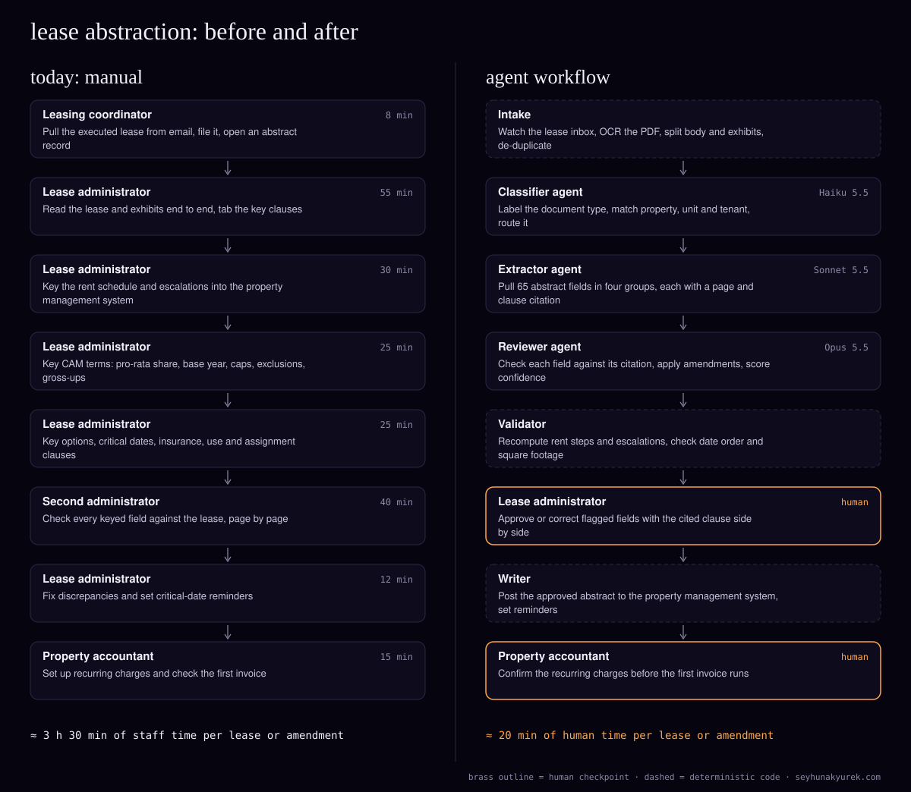

# Agent architecture teardowns

Five common industry bottlenecks, each re-engineered as a multi-agent AI workflow. Every post diagrams the manual process beside the agent architecture, then shows the exact agents, models, human checkpoints, failure modes, evaluation plan and **API costs worked out from Claude list prices**.

| process | summary |
|---|---|
| [I re-engineered freight invoice audit](posts/freight-invoice-audit-agent-workflow.md) | Auditing 25,000 carrier invoices a month with deterministic rating code and four Claude agents costs about $292 a month in API fees, modelled to save around 3,000 staff hours. |
| [I re-engineered P&C claims intake (first notice of loss)](posts/insurance-claims-intake-agent-workflow.md) | A five-agent FNOL intake workflow for 9,000 motor and home claims a month, modelled at about $0.28 of API cost per claim and $2,517 a month. |
| [I re-engineered lease abstraction](posts/lease-abstraction-agent-workflow.md) | A four-agent lease abstraction workflow for 120 leases a month costs about $81 a month in API calls and is modelled to save 380 staff hours. |
| [I re-engineered prior authorization](posts/prior-authorization-agent-workflow.md) | A multi-agent prior-authorization workflow for a specialty practice doing 3,000 requests a month. About $330 a month in API costs and a modelled 1,900 staff hours saved. |
| [I re-engineered SME credit memo preparation](posts/sme-credit-memo-agent-workflow.md) | A six-agent workflow that prepares SME credit memos for committee at about $1.20 in API cost per application, cutting staff time from 13.5 hours to a modelled 2.5. |

## What's in here

- `posts/`: the posts in Markdown.
- `diagrams/`: the before/after diagrams, as SVG, plus the JSON spec each one is drawn from.
- `scripts/render-diagrams.mjs`: redraws every SVG from its spec, with no dependencies (`node scripts/render-diagrams.mjs`).
- `BRIEF.md`: the template each post follows, so you can write your own.

## Honesty note

The firms are composites. The volumes are typical for each segment, and every cost is computed from Claude API list prices on 10 November 2026. Labour rates and volumes are stated assumptions. Check prices at https://platform.claude.com/docs/en/about-claude/pricing before you rely on them.

## Run your own numbers

The free tools at https://seyhunakyurek.com/tools are open source too: https://github.com/seyhunak/ai-buyer-tools

## License

Text and diagrams: [CC BY 4.0](https://creativecommons.org/licenses/by/4.0/). Credit "Seyhun Akyürek, https://seyhunakyurek.com". Scripts: MIT.

Written by [Seyhun Akyürek](https://seyhunakyurek.com). If you want this done on your own process, [get in touch](https://seyhunakyurek.com/contact).
