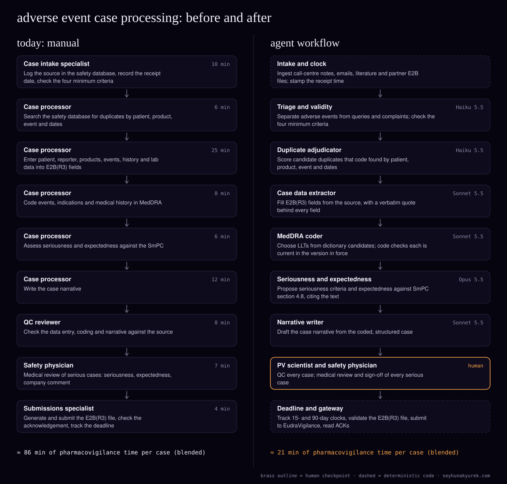

> Also published at https://seyhunakyurek.com/blog/adverse-event-case-processing-agent-workflow

Every report of a suspected adverse reaction starts a clock. A patient calls the medical information line about a rash. A pharmacist emails about a fall in an elderly patient. A journal article describes a liver injury in a case series. A licence partner sends an E2B file overnight. Each one has to be checked, de-duplicated, entered, coded, assessed, written up and, if it is a valid case, submitted to the regulator on time. Late submissions show up in inspections.

The company here is a mid-size marketing authorisation holder (MAH) in the EU, with about 30 authorised products and a pharmacovigilance team of case processors, PV scientists and two safety physicians under the QPPV. It receives about 1,500 cases a month: 675 from call-centre and medical information notes, 300 from emails and web forms, 225 from literature screening and 300 from licence-partner E2B feeds. About 35% turn out to be serious.

Most of case processing is transcription and lookup: copy facts from free text into structured fields, find the MedDRA term, compare the event with section 4.8 of the SmPC. Models do that well when code checks every field. The judgement on seriousness and expectedness stays with a PV scientist and a safety physician.

The company here is a composite: the volumes are typical for a mid-size EU MAH, and every cost below is computed from Claude API list prices on 10 November 2026. Nothing here is regulatory advice; check every requirement against the current GVP modules and your own PV system master file.

## the process today

| step | who | minutes |
|---|---|---|
| Log the source in the safety database, record the receipt date, check the four minimum criteria | Case intake specialist | 10 |
| Search the safety database for duplicates by patient, product, event and dates | Case processor | 6 |
| Enter patient, reporter, products, events, history and lab data into E2B(R3) fields | Case processor | 25 |
| Code events, indications and medical history in MedDRA | Case processor | 8 |
| Assess seriousness and expectedness against the SmPC | Case processor | 6 |
| Write the case narrative | Case processor | 12 |
| Check the data entry, coding and narrative against the source | QC reviewer | 8 |
| Medical review of serious cases (about 20 minutes each, averaged over all cases) | Safety physician | 7 |
| Generate and submit the E2B(R3) file, check the acknowledgement, track the deadline | Submissions specialist | 4 |
| **Total per case (blended)** | | **86** |

These are blended averages for the initial version of each case. A clean non-serious consumer report takes about 40 minutes; a serious literature case with a long medical history can take half a day. At 1,500 cases a month the blend is 2,150 hours, about 13 people. Follow-up versions, which arrive for a large share of serious cases, are on top of that and left out of every number below.

The time goes into reading messy sources and re-keying them. A call-centre note gives the onset as "about a week after starting", and someone has to work out a date. The errors come from the same places. A duplicate slips through because the partner's file has the patient's age and the call-centre note has the year of birth. "Fainted and was kept in overnight" is coded as syncope but not marked as a hospitalisation. The receipt date is logged as the day the email was opened, not the day it arrived in a shared inbox, and the 15-day clock is two days shorter than anyone thinks.

## the agent architecture

The pattern is a pipeline with a router after triage. Cases flagged as possibly serious run in real time; the rest run through the Batch API. I chose a pipeline because the order is fixed and auditable: you can't code an event before it is extracted, and you can't assess expectedness before the event is coded.

The regulatory frame is EU GVP Module VI. Its timelines, as I understand them for the post-authorisation setting: valid serious cases go to EudraVigilance within 15 calendar days and valid non-serious cases within 90, counted from day zero, the date on which anyone in the MAH's organisation (including partners acting for it) first has the four minimum criteria. Significant follow-up information starts a new clock. Expectedness does not change the EU post-authorisation clock, but it is recorded on the case and feeds signal detection and periodic reports.

Intake, the receipt timestamp, the duplicate candidate search, MedDRA code verification, the IME list check, deadline tracking, E2B(R3) generation and the gateway submission are ordinary code. No agent can submit to a regulator, nullify a case, close a case or change a deadline.

### intake and clock (deterministic)

Code ingests every channel into the safety database (Argus, ArisGlobal LifeSphere, Veeva Vault Safety or similar): CRM records from the call centre, a monitored PV mailbox, literature hits and partner E2B(R3) XML, which code parses field by field. Scans and PDFs go through OCR. The receipt timestamp is when the source first reached any company system, not when someone opened it. It is the default day zero, and only a person can move it.

Literature covered by EMA's Medical Literature Monitoring service is entered into EudraVigilance by EMA, so code drops those hits using a substance list you maintain.

### triage and validity agent

- **Job:** decide whether the source holds an adverse event (or a medical information query, a quality complaint, or a special situation such as a medication error), split multi-patient sources, and check the four minimum criteria: an identifiable patient, an identifiable reporter, a suspect product and an adverse event. It flags possibly serious cases for the real-time path.
- **Model:** Haiku 5.5. This is classification over short text against written rules, and it runs on every source.
- **Inputs and outputs:** the source and a cached prompt with the validity rules. It returns a verdict per criterion with the quote that meets it, a possibly-serious flag and a confidence score.
- **Guardrails:** it is told to over-flag, and any term on the EMA's Important Medical Events list (matched by code) forces the real-time path. A not-valid source is never discarded: it goes to a processor with a drafted follow-up request. Below 0.85 confidence, a person decides.

### duplicate adjudicator agent

- **Job:** compare a new case with the candidates code found and say which, if any, describe the same patient and event.
- **Model:** Haiku 5.5. Code does the search (fuzzy match on initials, age or date of birth, sex, product, event terms, onset dates, reporter and country); the model only compares a handful of short records.
- **Outputs:** likely, possible or distinct for each of up to five candidates, with the matching and conflicting fields.
- **Guardrails:** it never merges. A processor decides whether the source is a follow-up to an existing case, and a duplicate found after submission is nullified by a person.

### case data extractor agent

- **Job:** fill the E2B(R3) fields from the source: patient characteristics (section D), each reaction or event with onset, duration and outcome (E), tests (F), each drug with role, dose, route, dates, indication and action taken (G), and the reporter.
- **Model:** Sonnet 5.5. It is extraction with citations from untidy text, often in German, French, Spanish or Italian, and dates need careful reasoning ("two days after the second dose").
- **Inputs and outputs:** the source and a cached field guide with the company's conventions. It returns structured fields, each with the exact quote it came from.
- **Guardrails:** code checks every quote exists word for word in the source, every date is valid and in order, and every product matches a company product or a known concomitant. A failed check is retried once, then the field is left empty for the processor. Nothing is guessed.

### MedDRA coder agent

- **Job:** code each event, indication and medical history term to a MedDRA Lowest Level Term.
- **Model:** Sonnet 5.5. Code retrieves the top candidate LLTs from the licensed dictionary for each verbatim; the model chooses between them using the context, following the MedDRA Term Selection: Points to Consider document and the company's coding conventions.
- **Inputs and outputs:** the verbatim terms with surrounding text, the candidates and the conventions as a cached prefix. It returns one LLT code per term, or "needs coder".
- **Guardrails:** code verifies every LLT code exists in the MedDRA version in force, is flagged current, and maps to the expected Preferred Term and primary System Organ Class. A failing code goes to a person. MedDRA is licensed through the MSSO, so the dictionary sits in the company's environment under its own subscription. New versions come twice a year and the EMA announces when EudraVigilance moves; the version in force is configuration, not something the model knows.

### seriousness and expectedness assessor agent

- **Job:** propose, per event, which ICH seriousness criteria apply (death, life-threatening, hospitalisation or prolongation of it, persistent or significant disability, congenital anomaly, or other medically important condition) and whether the event is expected against section 4.8 of the SmPC that is the reference safety information for that product.
- **Model:** Opus 5.5. This is the judgement step. "Kept in A&E for six hours" may or may not be a hospitalisation; a listed "hepatic enzyme increased" does not make a reported hepatic failure expected. A wrong "non-serious" moves a case from a 15-day to a 90-day clock, so it runs on every case, not just the flagged ones.
- **Inputs and outputs:** the coded case and the product's current SmPC sections 4.8 and 4.4 (cached per product). It returns a criterion per event with the source quote, and an expectedness verdict with the SmPC text it compared against.
- **Guardrails:** code overrides toward serious: an IME-list term or a death makes the case serious unless a physician downgrades it. Code checks every quoted SmPC sentence exists in the version in force. The output is a proposal for the reviewers to confirm or change.

### narrative writer agent

- **Job:** draft the case narrative (E2B section H) in the company's standard order, ending with what is still unknown.
- **Model:** Sonnet 5.5. It is structured writing from structured data.
- **Guardrails:** it writes only from the verified fields and the source quotes. Code checks every date, dose and term in the narrative against the structured case. It writes no company causality comment; that belongs to the physician.

### human checkpoint

Every case is checked by a person before it can be submitted. How deep depends on what the pipeline found:

- **Valid, non-serious, no flags (about 50% of cases):** a PV case processor checks the fields against the source and approves, about eight minutes.
- **Invalid sources, possible duplicates, special situations and low-confidence coding (about 15%):** the processor works the flags, about 18 minutes.
- **Serious cases (about 35%):** a PV scientist reviews the full case (about 20 minutes) and a safety physician confirms seriousness, expectedness and the company comment (about 15 minutes).

A physician also sees any pregnancy outcome, paediatric case, or disagreement between code and model on seriousness. About two minutes per case stays with intake and submissions.

### deadline and gateway (deterministic)

Code computes each due date from day zero and the confirmed seriousness, and keeps a board of open cases by days left, with alerts at day 7 and day 12 for serious ones. On sign-off, the safety database generates the E2B(R3) file; code validates it against the EU business rules, submits it through the EMA Gateway or a gateway provider, and reads the acknowledgement. Every agent output, prompt version, MedDRA version and reviewer edit goes into an audit log.

## the exact flow

1. A source arrives. Code stamps the receipt time, OCRs scans with two retries and parses partner E2B files; a file that won't parse goes to intake.
2. Triage classifies the source and checks the four criteria; code runs the IME match. Possibly serious cases go real time, the rest into a Batch API job every few hours.
3. Not-valid sources go to a processor with a drafted follow-up request; day zero is set when the last criterion arrives.
4. Code finds duplicate candidates and the adjudicator scores them. Likely duplicates stop for a processor.
5. The extractor fills the E2B(R3) fields; failed checks are retried once, then left empty.
6. The coder picks LLTs; codes that fail verification go to a person.
7. The assessor proposes seriousness and expectedness; code applies the serious overrides.
8. The narrative writer drafts section H; code checks it against the fields.
9. The case enters the review queue in deadline order. The processor approves or edits; serious cases go on to the physician. Every edit, with its reason, goes into the golden set.
10. On sign-off, code generates, validates and submits the file. A rejected acknowledgement goes back to submissions the same day.
11. Follow-up sources run the same steps against the existing case; code resets the clock if the information is significant.

If the API is down, sources still land with their timestamps and processors work them by hand. The deadline board needs no model.

## the api costs

Possibly serious cases (about 40%, because triage over-flags) run in real time. The other 60% are batched at 50% off: a non-serious case has a 90-day clock, and a batch that returns within hours costs it nothing. Triage itself always runs in real time, since it decides the path. The cached prefixes (validity rules, field guide, coding conventions, narrative template and each product's SmPC sections) are stable. For batched calls I assume one cache write per 20 calls; batch cache hits are best effort, so that is a modelling assumption. Real-time calls arrive a few an hour, so I assume half find the 5-minute cache warm, except the assessor, whose SmPC prefix is per product across 30 products: I assume only 20% warm there.

Token counts are per call. Cost per unit is the average cost per call times the calls per case, so the column sums to the cost of an average case. Output includes thinking: 500 tokens for the extractor, 300 for the coder, 1,200 for the assessor. Call counts include 5 to 10% retries.

| agent | model | input tokens | cached input tokens | output tokens | cost per unit |
|---|---|---|---|---|---|
| Triage and validity (1 call, real time) | Haiku 5.5 | 3,500 | 3,000 | 400 | $0.000753 |
| Duplicate adjudicator (0.6 calls, 60% batch) | Haiku 5.5 | 4,000 | 2,000 | 300 | $0.000269 |
| Case data extractor (1.1 calls, 60% batch) | Sonnet 5.5 | 5,000 | 6,000 | 2,500 | $0.030818 |
| MedDRA coder (1.05 calls, 60% batch) | Sonnet 5.5 | 3,000 | 4,000 | 1,000 | $0.014221 |
| Seriousness and expectedness (1.05 calls, 60% batch) | Opus 5.5 | 4,000 | 10,000 | 2,000 | $0.059514 |
| Narrative writer (1 call, 60% batch) | Sonnet 5.5 | 4,000 | 3,000 | 1,200 | $0.015758 |
| **Total per case** | | | | | **$0.121333** |

The assessor row, worked through. A batched call: 4,000 uncached input tokens at $4.00 per million is $0.016. The 10,000 cached tokens bill at 95% cache reads ($0.20) and 5% writes ($5.00), an effective $0.44 per million, so $0.0044. The 2,000 output tokens at $20.00 per million are $0.040. That is $0.0604, halved by the Batch API to $0.0302. A real-time call has the same tokens but 80% of its cache tokens are writes, an effective $4.04 per million, so it costs $0.0964. With 60% of calls batched the average call is $0.05668. At 1.05 calls per case that is $0.059514 per case, or $89.27 a month.

At 1,500 cases the API bill is **$182.00 a month**, about 12 cents a case: the assessor $89.27, the extractor $46.23, the narrative writer $23.64, the coder $21.33, triage $1.13 and the duplicate adjudicator $0.40. Without caching or batching the same workload would cost about $308.

| item | monthly |
|---|---|
| Claude API (all agents) | $182.00 |
| Hosting: queue, workers, database (estimate) | $300 |
| Observability and audit logging (estimate) | $150 |
| OCR for faxes, scans and literature PDFs (estimate) | $60 |
| MedDRA candidate search index (estimate) | $40 |
| Document storage (estimate) | $30 |
| **Total running cost** | **$762.00** |
| PV time today (86 min × 1,500) | 2,150 hours |
| PV time after (20.95 min × 1,500) | 523.75 hours |
| **Modelled hours saved** | **1,626.25 hours** |
| Labour value at $75/hour | $121,968.75 |

The safety database and the MedDRA subscription are left out: the company pays for both already. The $75 is my assumed blended, fully loaded rate for case processors, PV scientists and safety physicians in Western Europe, in US dollars. The 20.95 minutes is 50% × 8 for clean non-serious cases, 15% × 18 for flagged ones, 35% × 35 for serious cases, and 2 minutes of intake and submissions time on every case. Many MAHs outsource case processing to a PV service provider; then the saving shows up in the next contract's per-case price, not in headcount. The hours are capacity, not a headcount plan, and validation of the system is a real cost the table does not include.

## what it will get wrong

- **A serious case called non-serious.** The worst error, because it moves the deadline. The IME and death overrides are code, the assessor runs on every case, and the golden set is weighted toward borderline hospitalisations.
- **The wrong day zero.** A model can't know when an email reached the shared inbox. Day zero comes from system timestamps, and only a person can change it, with a reason.
- **A missed duplicate, or a false one.** Code normalises ages and dates before the search, and no merge happens without a person.
- **A non-current MedDRA term.** Code verifies every code against the version in force, and every upgrade triggers a golden-set re-run first.
- **Expected by association.** A listed lab abnormality does not make the clinical syndrome expected. The assessor must quote the exact SmPC text, and a match on the SOC alone is not accepted.
- **Confident translation.** The extractor quotes the original language, so the reviewer sees the source words, not just a translation.
- **Personal health data.** Case data is special category data under GDPR. Each step gets only what it needs, and the model provider sits under the company's data processing agreement.
- **Instructions in the source.** Source text is data. No agent can submit, nullify, merge or close, so the worst case is a wrong draft field.

## how you know it works

Build a golden set of 800 signed-off cases from the last two years: 300 serious, 350 non-serious, 80 not valid, 70 known duplicates, with literature, partner files, special situations, pregnancy and paediatric cases in proportion. Two senior PV scientists label 100 of them independently, because the history isn't perfectly consistent either.

The bar for go-live:

- **Seriousness recall:** 100% of serious cases flagged serious by the pipeline before human review. Pass or fail.
- **Seriousness precision:** 80%. False serious flags cost physician minutes, not deadlines.
- **Validity accuracy:** 98% on the four criteria, with no valid case marked not valid without a person seeing it.
- **Duplicate recall:** 95% of known duplicates surfaced as likely or possible.
- **Field-level extraction accuracy:** 97% across E2B fields, 99% on dates, product, dose and outcome.
- **MedDRA coding agreement:** 92% exact LLT match with the reference coder, 98% at Preferred Term level, 100% of codes current. The last is pass or fail.
- **Expectedness agreement:** 95% with the safety physician's final call.
- **Escalation rate:** under 20% of non-serious cases flagged, or the review saving disappears.
- **Cycle time:** 100% of serious cases ready for physician review by day 7, and no deadline missed in shadow mode.

The system is part of your pharmacovigilance system, so it needs to be validated as a computerised system and described in the PSMF. After go-live, every reviewer edit feeds the golden set, and it is re-run after any prompt, model, SmPC or MedDRA version change.

## the build plan

- **Week 1:** agree scope, review tiers and escalation rules with the QPPV. Pull the golden set and write the validation plan.
- **Week 2:** intake connectors, timestamps, OCR, partner E2B parsing and the deadline board, which can go live on its own.
- **Week 3:** triage and validity agent, the IME list match and the follow-up request drafts.
- **Week 4:** duplicate search and adjudicator, tested on the 70 known duplicates.
- **Week 5:** case data extractor and the quote and date checks.
- **Week 6:** MedDRA candidate search, the coder and code verification against the licensed version.
- **Week 7:** seriousness and expectedness assessor, the per-product SmPC library with versions, and the serious overrides.
- **Week 8:** narrative writer, the review queue screen, the audit log and E2B validation. Full golden-set run.
- **Week 9:** shadow mode on live cases, compared daily with the team's own processing. Submissions stay manual.
- **Week 10:** validation report and QPPV sign-off; live for non-serious cases with full review, serious cases after two clean weeks.

## run your own numbers

The [AI token cost estimator](https://seyhunakyurek.com/tools/ai-token-cost-estimator?model=claude-sonnet-5-5&requests=8700&input=8836&output=1324&cached=56&batch=50) is pre-filled with this workload averaged across agents: 8,700 calls a month, 8,836 input and 1,324 output tokens per call, 56% of input cached, 50% of calls batched. It prices every call at Sonnet 5.5, so it reads differently from the mixed-model table above.

The golden set only earns its keep if you can tell a real improvement from noise. When MedDRA moves to a new version, or you change the assessor prompt, the [LLM eval A/B test calculator](https://seyhunakyurek.com/tools/llm-eval-ab-test-calculator) takes the old and new runs on the same 800 cases and uses a paired McNemar test to say whether B really beats A, and how many cases you need before you can trust the answer.

The review tiers rest on confidence thresholds. The [escalation threshold calculator](https://seyhunakyurek.com/tools/escalation-threshold-calculator) shows what moving the cut-off does to the share of cases a PV scientist sees and to the errors that get through.

If you want this mapped onto your channels, your products and your safety database, [book a 20-minute call](https://seyhunakyurek.com/contact).
