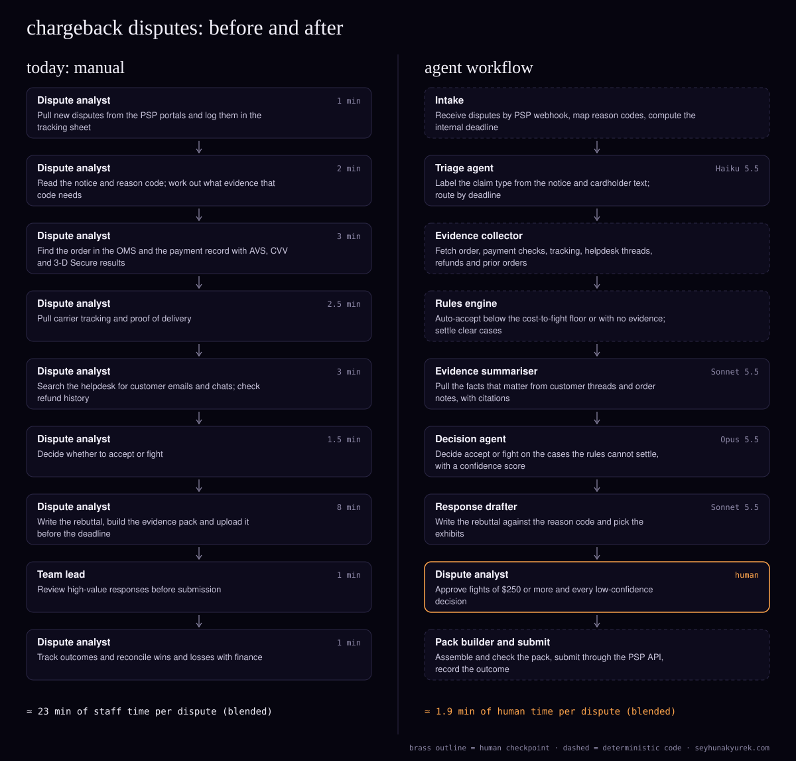

> Also published at https://seyhunakyurek.com/blog/chargeback-dispute-agent-workflow

Chargeback representment is a deadline job done by hand. A dispute lands in the PSP's portal with a reason code, a cardholder claim and a clock. Someone has to gather the evidence, decide whether to fight, and upload a response pack before the window closes. Miss it and the dispute is lost.

The merchant here is a mid-sized US e-commerce business selling physical goods through one or two PSPs (Stripe, Adyen, Checkout.com or Braintree). It receives about 4,000 disputes a month across Visa, Mastercard and Amex. When the analysts' queue gets long, they accept cases they could have won.

Most of the work is fetching records, which is plain code. The models read claims and email threads, weigh grey cases and write rebuttals.

The merchant here is a composite: the volumes are typical for the segment, and every cost below is computed from Claude API list prices on 10 November 2026.

## the process today

| step | who | minutes |
|---|---|---|
| Pull new disputes from the PSP portals and log them | Dispute analyst | 1.0 |
| Read the notice and reason code; work out the evidence it needs | Dispute analyst | 2.0 |
| Find the order and the payment record with AVS, CVV and 3-D Secure results | Dispute analyst | 3.0 |
| Pull carrier tracking and proof of delivery | Dispute analyst | 2.5 |
| Search the helpdesk for customer contact; check refund history | Dispute analyst | 3.0 |
| Decide whether to accept or fight | Dispute analyst | 1.5 |
| Write the rebuttal, build the evidence pack and upload it | Dispute analyst | 8.0 |
| Review high-value responses | Team lead | 1.0 |
| Track outcomes and reconcile with finance | Dispute analyst | 1.0 |
| **Total per dispute (blended)** | | **23.0** |

These are blended averages. At 4,000 disputes that is about 1,533 hours a month, or nearly ten full-time analysts. I assume the team fights about 40% of disputes today.

The time goes into lookups across the PSP portal, the order management system, carrier tracking, the helpdesk (Zendesk, Gorgias or Freshdesk) and the refund ledger. The errors come from there too. Each reason-code family wants different evidence, and a pack that answers the wrong claim loses. A refund issued last week gets missed, so the merchant fights a dispute it already paid. The customer's "it arrived, thanks" email sits in a thread nobody searched. And the processor's deadline is shorter than the network's, so cases expire in the queue.

## the agent architecture

The pattern is a pipeline with a router after the rules engine. Every dispute goes through intake, triage and evidence collection in order; the rules engine then sends it to auto-accept, a rules-settled fight, or the decision agent. The order never changes, so an orchestrating LLM would add cost without adding a decision. Everything marked deterministic below is ordinary code.

### intake (deterministic)

The PSP sends a webhook per dispute. Code fetches it, maps the network reason code to an internal claim family (fraud, not received, not as described, cancelled or subscription, credit not processed, processing error) and computes the deadline. Network response windows are often 20 to 30 days and the processor's internal deadline is shorter, so the system works to the processor's date with a two-day margin.

### triage agent

- **Job:** label the actual claim from the notice and any cardholder text. A "not as described" code can hide a "never arrived" story; a fraud code is sometimes a forgotten subscription.
- **Model:** Haiku 5.5. Short classification on every dispute, 4,000 times a month.
- **Inputs and outputs:** the notice, reason code, amount and a cached claim taxonomy; returns a label, a confidence score and a reason. No tools.
- **Guardrails:** if the label disagrees with the reason-code family, the drafter still answers the network's code. Under 0.85 confidence goes to manual triage. It runs in real time.

### evidence collector (deterministic)

Code calls each system read-only: the order from the OMS (items, addresses, IP, device ID where captured), the PSP payment record (AVS and CVV results, 3-D Secure outcome, risk score), tracking and proof of delivery from the carrier's tracking API, helpdesk threads by email and order number, refunds and credits, and the customer's earlier undisputed orders. That matters because Visa's dispute rules, including Compelling Evidence 3.0 for some card-absent fraud disputes, can count earlier undisputed transactions with matching IP or device as evidence.

The agents see the PSP's payment token, the last four digits, the card brand and the check results, never a full PAN. That keeps them out of PCI DSS cardholder-data scope, though your QSA should confirm the boundary.

### rules engine (deterministic)

About 40% of disputes are settled without a model. It accepts when the amount is under the cost-to-fight floor ($25 by default), when a not-received claim has no tracking, or when a fraud claim lacks the evidence the rules require. It fights when a refund was already issued for the order, or when the payment was authenticated with 3-D Secure and the claim is in a family where that typically shifts liability. The other 60% go to the decision agent.

### evidence summariser agent

- **Job:** pull the facts that matter from helpdesk threads, chats and order notes: an admission of receipt, a return never sent, a dated cancellation request.
- **Model:** Sonnet 5.5. Extraction from messy text with judgement about relevance.
- **Inputs and outputs:** the threads, the claim label, and a cached guide to what each claim family needs; returns facts, each with a quote and a source link. It runs on the 70% of disputes with customer contact.
- **Guardrails:** code checks every quote appears verbatim in the source, and drops any that don't.

### decision agent

- **Job:** decide accept or fight on what the rules cannot settle, and say why.
- **Model:** Opus 5.5. This is the judgement step. A wrong call either wastes a fight or gives away a winnable case.
- **Inputs:** the claim, the evidence record, the summariser's facts, and a cached policy: the cost-to-fight floor, the evidence each claim family needs under Visa's rules and Mastercard's chargeback guide, and customer-level rules.
- **Outputs:** accept or fight, the evidence that carries the case, what is missing, and a confidence score. No tools.
- **Guardrails:** it cannot submit or accept anything. Below 0.75 confidence the case goes to the analyst.

### response drafter agent

- **Job:** write the rebuttal for each fight and choose the exhibits.
- **Model:** Sonnet 5.5. Drafting from structured facts against a template.
- **Inputs and outputs:** the decision, evidence and cached templates per claim family; returns the rebuttal, exhibits and the PSP's evidence fields.
- **Guardrails:** code checks every fact maps to an exhibit and that order number, amount and dates match the dispute.

### pack builder and submission (deterministic)

Code assembles the exhibits in the PSP's format, redacts internal notes, checks file types and size limits, and submits through the PSP API after approval. Outcomes post to the ledger by webhook.

### human checkpoints

- **Dispute analyst:** approves every fight of $250 or more, every decision under 0.75 confidence and every triage label under 0.85, and handles pre-arbitration.
- **Policy rules** escalate regardless of score: a customer flagged for abuse, an order over $1,000, or a case within two days of its deadline.

## the exact flow

1. Intake fetches the dispute, maps the code and sets the deadline. API failures retry with backoff; a dispute not fetched within an hour alerts.
2. Triage labels the claim in real time; low confidence goes to manual triage.
3. The collector fetches every record. A missing system retries three times over six hours, then the case proceeds with the gap marked.
4. The rules engine auto-accepts or settles clear cases. Accepts post to the ledger.
5. Cases with customer contact join the summariser's evening Batch API job, which typically returns overnight. Unverified quotes are dropped.
6. Unsettled cases join the decision agent's nightly batch. Low-confidence decisions go to the analyst.
7. Fights go to the drafter in the next batch cycle. A draft that fails the checks is regenerated once, then goes to the analyst.
8. Fights under $250 that pass every check are submitted; larger ones reach the analyst each morning.
9. Outcomes post to the ledger. Losses with a pre-arbitration option go to the analyst.
10. Any case within three days of its deadline, or stuck behind a Batch API outage, runs in real time.

## the api costs

The summariser, decision agent and drafter run through the Batch API at 50% off; only triage runs in real time. Cached prefixes (taxonomy, guide, policy, templates) are stable; I assume one cache write per 20 calls, a modelling assumption since batch cache hits are best effort.

Cost per unit is the per-call cost times the share of disputes reaching that agent. Output includes thinking: 300 tokens for the summariser, 1,800 for the decision agent, 400 for the drafter.

| agent | model | input tokens | cached input tokens | output tokens | cost per unit |
|---|---|---|---|---|---|
| Triage (100%, real time) | Haiku 5.5 | 2,500 | 1,500 | 200 | $0.000224 |
| Evidence summariser (70%, batch) | Sonnet 5.5 | 12,000 | 3,000 | 1,500 | $0.011781 |
| Decision agent (60%, batch) | Opus 5.5 | 10,000 | 5,000 | 2,500 | $0.021660 |
| Response drafter (55%, batch) | Sonnet 5.5 | 14,000 | 6,000 | 2,000 | $0.010263 |
| **Total per dispute** | | | | | **$0.043928** |

The decision agent row, worked through: 5,000 uncached input tokens at $4.00 per million is $0.020. The 5,000 cached tokens bill at 95% cache reads ($0.20) and 5% writes ($5.00), an effective $0.44 per million, so $0.0022. The 2,500 output tokens at $20.00 per million are $0.050. That is $0.0722 per call, halved by batching to $0.0361. On 60% of disputes it adds $0.02166 per dispute, or $86.64 a month.

At 4,000 disputes the API bill is **about $176 a month**: decision agent $86.64, summariser $47.12, drafter $41.05, triage $0.89. Without caching or batching it would be about $432. If 5% of disputes take the real-time path, add about $9.

| item | monthly |
|---|---|
| Claude API (all agents) | $176 |
| PDF assembly and conversion (estimate) | $30 |
| Hosting: queue, workers, database (estimate) | $250 |
| Evidence storage (estimate) | $20 |
| Observability and logging (estimate) | $120 |
| **Total running cost** | **$596** |
| Staff time today (23.0 min × 4,000) | 1,533 hours |
| Staff time after (1.88 min × 4,000) | 125 hours |
| **Modelled hours saved** | **1,408 hours** |
| Labour value at $42/hour | $59,136 |

The $42 is a fully loaded US rate for dispute analysts. The 1.88 minutes is modelled as approvals on 20% of disputes at 4 minutes, low-confidence decisions on 8% at 8 minutes, manual triage on 3% at 3 minutes, pre-arbitration on 5% at 6 minutes, and 0.05 minutes of ledger checks.

The table leaves out recovered revenue. As a labelled assumption only: at an average disputed amount of $95, each point of overall recovery (disputes won as a share of all disputes) is worth about $3,800 a month. Fighting 55% instead of 40% should move it; by how much, I won't guess without your data.

## what it will get wrong

- **Fighting a dispute already refunded.** The rules engine checks refunds by order first, and the drafter cannot fight a refunded order without citing the credit.
- **A quote that isn't there.** Verbatim matching drops paraphrased quotes.
- **Delivered to the wrong address.** The collector compares the carrier's delivery location with the shipping address; a mismatch removes "delivered" as evidence.
- **Friendly fraud that isn't.** Prior orders on the same device only count with no takeover signals, and the analyst sees every fraud fight over $250.
- **A missed deadline.** The deadline rule moves cases to real time, and an alert fires on any case within a day of its date.
- **Instructions hidden in a customer email.** Thread text is data. No agent can submit, accept or refund, so the worst case is a wrong draft that code or the analyst catches.

## how you know it works

Build a golden set of 800 closed disputes from the last year, stratified by claim family and network, with at least 150 fraud and 150 not-received cases, including accepted cases a reviewer now thinks were winnable. Two analysts label each independently.

The bar for go-live:

- **Evidence completeness:** 98% of required evidence fields present in the pack.
- **Decision agreement:** 90% with reviewers on accept versus fight, and every case they marked uncertain escalated.
- **Refund catch:** 100% of seeded already-refunded disputes caught. Pass or fail.
- **Quote accuracy:** 100% of rebuttal quotes verbatim in the source.
- **Escalation rate:** 40% or fewer disputes reach a person (36% modelled), falling toward 30%.
- **Cycle time:** 95% of fights submitted at least two days before the deadline.

Analyst overrides feed the golden set monthly. Win rate lags by weeks, so it is a trend line, not a gate.

## the build plan

- **Week 1:** map PSPs, reason codes and claim families; agree the cost-to-fight policy with finance; pull the golden set.
- **Week 2:** intake: webhooks, reason-code mapping, deadlines.
- **Week 3:** evidence collector and rules engine, tested on closed disputes with no LLM.
- **Week 4:** triage and summariser, tuned on the golden set.
- **Week 5:** decision agent; review every golden-set decision with the lead analyst.
- **Week 6:** drafter, templates and pack builder against the PSP's test environment.
- **Week 7:** shadow mode on live disputes, compared daily with the team.
- **Week 8:** live for not-received and credit-not-processed claims, every fight approved by an analyst.
- **Week 9:** add fraud and not-as-described. Move to the $250 threshold once agreement holds at 90% for two weeks.
- **Week 10:** handover: runbook, dashboards, monthly golden-set runs.

## run your own numbers

The [AI token cost estimator](https://seyhunakyurek.com/tools/ai-token-cost-estimator?model=claude-sonnet-5-5&requests=11400&input=8632&output=1351&cached=40&batch=65) is pre-filled with this workload averaged across agents: 11,400 calls a month, 8,632 input and 1,351 output tokens per call, 40% of input cached, 65% of calls batched. It prices every call at Sonnet 5.5, so it reads differently from the mixed-model table above.

To see what changes if more of the simple accept and refund cases go to Haiku 5.5, use the [AI model routing calculator](https://seyhunakyurek.com/tools/ai-model-routing-calculator). To size the analyst queue for fights above the $250 limit, use the [human review staffing calculator](https://seyhunakyurek.com/tools/human-review-staffing-calculator).

If you want this mapped to your PSPs, reason codes and order data, [book a 20-minute call](https://seyhunakyurek.com/contact).
