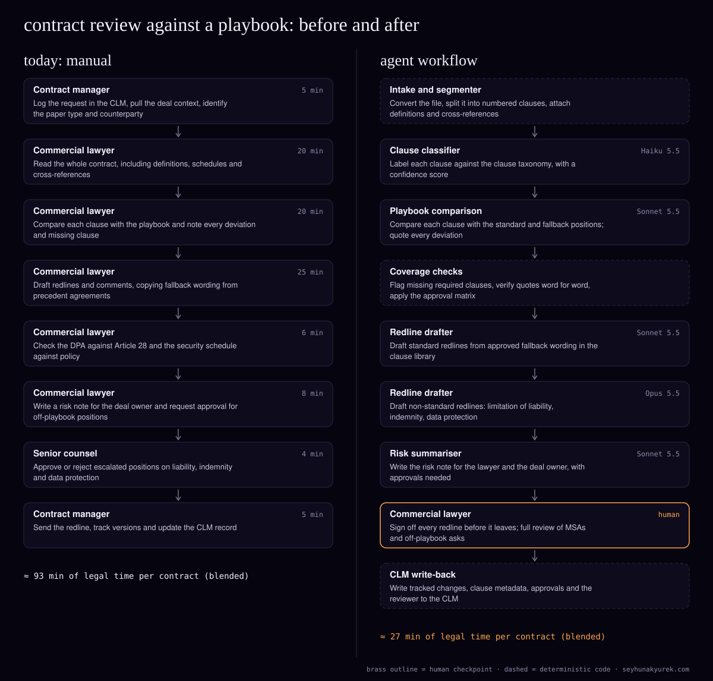

> Also published at https://seyhunakyurek.com/blog/contract-review-agent-workflow

Every B2B deal and every new supplier arrives with someone else's paper. A prospect sends its mutual NDA before the first demo. A customer's procurement team sends its own MSA with a data processing agreement attached. A vendor sends terms that cap its liability at one month of fees. Each one waits in the legal queue, and sales asks every morning where it is.

The team here is in-house legal at a mid-size B2B SaaS company in the UK, selling to UK, EU and US customers. Two commercial lawyers, a senior counsel and a contract manager handle about 400 inbound contracts a month: about 280 NDAs, 60 customer MSAs (most with a DPA), 20 standalone DPAs and 40 vendor agreements. The company has a negotiation playbook: for each clause, the standard position, the fallback positions a lawyer can accept alone, and the positions that need senior counsel or the CFO.

The playbook is the point. Most of the review is comparing a clause with a written position and drafting the approved fallback. That is careful reading against a fixed reference, which models do well, as long as a lawyer signs every word that leaves the building.

The team here is a composite: the volumes are typical for the segment, and every cost below is computed from Claude API list prices on 10 November 2026. Nothing here is legal advice, and the workflow does not give any: the lawyer's sign-off does.

## the process today

| step | who | minutes |
|---|---|---|
| Log the request in the CLM, pull the deal context, identify the paper type and counterparty | Contract manager | 5 |
| Read the whole contract, including definitions, schedules and cross-references | Commercial lawyer | 20 |
| Compare each clause with the playbook and note every deviation and missing clause | Commercial lawyer | 20 |
| Draft redlines and comments, copying fallback wording from precedent agreements | Commercial lawyer | 25 |
| Check the DPA against Article 28 and the security schedule against policy | Commercial lawyer | 6 |
| Write a risk note for the deal owner and request approval for off-playbook positions | Commercial lawyer | 8 |
| Approve or reject escalated positions on liability, indemnity and data protection | Senior counsel | 4 |
| Send the redline, track versions and update the CLM record | Contract manager | 5 |
| **Total per contract (blended)** | | **93** |

These are blended averages over the first full review of each contract. An NDA takes about 35 minutes; a customer MSA with a DPA can take most of a day. At 400 contracts a month the blend is 620 hours, roughly four people's time. Later turns, when the counterparty replies to the redline, are on top of that and left out of every number below.

The time goes into reading and re-finding. A lawyer reads an NDA that is 90% the same as the last forty, looking for the one clause that is not: a residuals clause, a non-solicit, a ten-year term, a governing law the company never accepts. The errors come from the same place. The cap looks fine, but "Losses" is defined to include lost profits. The indemnity is mutual in the heading and one-way in the text. The DPA lets the processor engage sub-processors with no notice. A clause the playbook requires is simply absent, and absence is the hardest thing to spot at the end of a long day.

## the agent architecture

The pattern is a pipeline with a router after the playbook comparison. Clauses that match the standard position skip the drafter; standard deviations go to the Sonnet drafter; limitation of liability, indemnity, data protection and IP deviations go to the Opus drafter. I chose a pipeline because the order is fixed: you can't compare a clause with the playbook until you know what kind of clause it is, and you can't draft a redline until you know what it deviates from.

Intake, segmentation, the missing-clause check, quote verification, the approval matrix, tracked-change generation and the CLM write-back are ordinary code. No agent can send a document to a counterparty, approve a position or write to the CLM.

### intake and clause segmenter (deterministic)

Requests come in through the CLM (Ironclad, DocuSign CLM, Agiloft or similar) from a sales or procurement intake form, which carries the deal context: annual contract value, the product, whether personal data is processed and where. Code converts Word and PDF files to text with their numbering, runs scanned PDFs through OCR, and splits the contract into clauses by numbering and headings. It builds a definitions map and a cross-reference map, so every clause travels with the defined terms and clauses it relies on. If the document is the company's own template returned with edits, code diffs it against the template and only the changed clauses go forward.

### clause classifier agent

- **Job:** label each clause with one or more types from the company's taxonomy of about 60 (confidentiality, term, limitation of liability, indemnity, IP ownership, data protection, sub-processors, governing law, non-solicit, assignment and so on).
- **Model:** Haiku 5.5. This is classification over short text against a fixed list, and it runs on every clause.
- **Inputs and outputs:** batches of about 15 clauses plus a cached prompt with the taxonomy, definitions and examples. It returns labels with a confidence score per clause.
- **Guardrails:** a label under 0.8 confidence, or a clause with three or more labels, goes to the comparison agent marked as uncertain rather than dropped. Code then checks the labels against the list of clause types the playbook requires for that paper type. A mutual NDA with no term, or an MSA with no limitation of liability, is flagged as missing before any model reasons about it.

### playbook comparison agent

- **Job:** compare each clause with the playbook for that paper type and governing law, and return one verdict: standard, acceptable fallback, deviation within lawyer authority, deviation needing escalation, or unclear.
- **Model:** Sonnet 5.5. Comparing wording with a written position needs careful reading of definitions and carve-outs, but the position itself is written down, so this is not open judgement.
- **Inputs:** the clauses with their labels, attached definitions and cross-references, the deal context, and the playbook (about 12,000 tokens per paper type) as a cached prefix.
- **Outputs:** per clause, the verdict, the playbook position it was tested against, the exact words that deviate, and a confidence score.
- **Guardrails:** code checks every quoted phrase exists word for word in the contract and every cited position exists in the playbook version in force. A failed check is retried once with the error, then marked unclear. Unclear is always an escalation, never a pass.

### redline drafter agent

- **Job:** draft the tracked change and a short comment to the counterparty for each deviation.
- **Model:** two tiers. Sonnet 5.5 for standard deviations, where the clause library holds approved fallback wording and the job is to fit it into the counterparty's drafting. Opus 5.5 for limitation of liability, indemnity, IP and data protection, where the fallback has to work with the counterparty's definitions, caps and carve-outs, and a drafting slip can leave the company exposed without a cap.
- **Inputs:** the deviating clause, its definitions, the verdict, the playbook position and the clause library as a cached prefix. For DPAs, the Opus drafter also gets a checklist of the processor terms GDPR Article 28(3) requires (the UK GDPR carries the same article), the company's sub-processor and international transfer positions, and the security schedule.
- **Outputs:** replacement text, a one-line external comment, an internal note on why, and a flag if the fix touches another clause.
- **Guardrails:** the drafter writes instructions, not documents. Code applies them to the Word file as tracked changes, and any instruction that does not apply cleanly to the source text is retried once, then left for the lawyer. Every defined term in the new text must exist in the contract or be defined in the change. The drafter can't move a position past the lawyer's authority; anything that would is drafted as a proposal and marked for approval.

### risk summariser agent

- **Job:** write the note the lawyer reads first and the deal owner reads at all: what the paper is, what deviates, what was redlined, what is left open and who has to approve what.
- **Model:** Sonnet 5.5. It is a short piece of writing over structured inputs, but it has to rank risk sensibly for a non-lawyer.
- **Inputs and outputs:** every verdict and redline, the deal context, and the approval matrix output from code. It returns a one-page summary and a list of open points.
- **Guardrails:** who must approve is decided by code from the approval matrix (for example, an uncapped indemnity goes to senior counsel, a cap below twelve months of fees to the CFO), not by the model. The summariser can only describe it.

### human checkpoint

A commercial lawyer signs off every redline before it leaves. How deep the review goes depends on what the pipeline found:

- **Clean or fallback-only NDAs (about 45% of contracts):** the lawyer checks the summary and the redline, about four minutes.
- **NDAs with off-fallback asks, standalone DPAs and simpler vendor agreements (about 35%):** a clause-by-clause check of the flagged deviations, about fifteen minutes.
- **Customer MSAs and complex vendor agreements (about 20%):** full review, about 90 minutes. The models save the first read and the first draft, not the thinking.

Escalation to senior counsel is triggered by the approval matrix, any clause marked unclear, any missing required clause on an MSA or DPA, a governing law outside the approved list, or a deal value above a threshold the team sets. The contract manager keeps about two minutes per contract for intake and the CLM.

### clm write-back (deterministic)

On sign-off, code writes the tracked-change file, the clause metadata (cap amount, term, governing law, renewal notice period), the approvals and the reviewer's name to the CLM record, and appends every agent output, model and prompt version, and the lawyer's edits to a log. When the playbook changes, code re-runs the comparison on open matters and lists signed contracts that now fall outside policy.

## the exact flow

1. A request arrives in the CLM with the deal context. Intake converts the file, OCRs scans with two retries, and segments it. A file that will not segment cleanly goes to the contract manager.
2. If the paper is the company's own template, code diffs it against the template and sends only the changed clauses on.
3. The clause classifier labels every clause. NDAs run in real time; MSAs, DPAs and vendor agreements go into a Batch API job.
4. Code checks the labels against the required clause list for the paper type and flags anything missing.
5. The playbook comparison agent returns a verdict per clause. Failed quote checks are retried once, then marked unclear.
6. The router sends standard deviations to the Sonnet drafter and liability, indemnity, IP and data protection deviations to the Opus drafter.
7. Code applies each redline as a tracked change and checks defined terms. A change that will not apply is retried once with the error, then left for the lawyer.
8. The risk summariser writes the note; code attaches the approvals required.
9. NDAs reach a lawyer the same morning or afternoon. Batched contracts reach a lawyer the next business morning, which is sooner than they are picked up today.
10. The lawyer approves, edits or rejects each redline. Every edit records a reason and goes into the golden set.
11. Escalated positions go to senior counsel or the CFO in the CLM's approval flow.
12. The contract manager sends the redline. When the counterparty replies, code diffs the new version against ours and only the changed clauses go back through steps 3 to 10.

If the API is unavailable, contracts wait in the queue, and urgent NDAs fall back to a lawyer working alone, as today.

## the api costs

NDAs are the speed promise to sales, so their calls run in real time. Everything else is batched at 50% off: MSAs, DPAs and vendor agreements take days to negotiate, and a lawyer picks them up the next morning either way. The cached prefixes (taxonomy, playbooks, clause library, summary format) are stable. For batched calls I assume one cache write per 20 calls; batch cache hits are best effort, so that is a modelling assumption. Real-time NDA calls arrive one or two an hour, so I assume only half of them find the 5-minute cache warm.

Token counts are per call. Cost per unit is the average cost per call times the calls per contract, so the column sums to the cost of an average contract. The average contract is about 8,600 tokens and 30 clauses, weighted by the mix. Output includes thinking: 600 tokens for the comparison agent, 400 for the standard drafter, 2,000 for the Opus drafter.

| agent | model | input tokens | cached input tokens | output tokens | cost per unit |
|---|---|---|---|---|---|
| Clause classifier (2.1 calls, 67% batch) | Haiku 5.5 | 4,000 | 4,000 | 600 | $0.001213 |
| Playbook comparison (2.0 calls, 65% batch) | Sonnet 5.5 | 4,000 | 12,000 | 1,500 | $0.043686 |
| Redline drafter, standard (0.756 calls incl. retries, 42% batch) | Sonnet 5.5 | 5,000 | 8,000 | 2,000 | $0.022819 |
| Redline drafter, non-standard (0.781 calls incl. retries, 95% batch) | Opus 5.5 | 9,000 | 10,000 | 3,500 | $0.046068 |
| Risk summariser (1 call, 30% batch) | Sonnet 5.5 | 5,000 | 3,000 | 900 | $0.018979 |
| **Total per contract** | | | | | **$0.132765** |

The Opus drafter row, worked through. A batched call: 9,000 uncached input tokens at $4.00 per million is $0.036. The 10,000 cached tokens bill at 95% cache reads ($0.20) and 5% writes ($5.00), an effective $0.44 per million, so $0.0044. The 3,500 output tokens at $20.00 per million are $0.070. That is $0.1104, halved by the Batch API to $0.0552. A real-time call has the same input and output but half its cache tokens are writes, an effective $2.60 per million, so it costs $0.132. With 95% of calls batched the average call is $0.058986. At 0.781 calls per contract (0.71 non-standard deviations per contract on average, plus 10% retries) that is $0.046068 per contract, or $18.43 a month.

At 400 contracts the API bill is **$53.11 a month**, about 13 cents a contract: the Opus drafter about $18.43, the comparison agent $17.47, the standard drafter $9.13, the summariser $7.59 and the classifier $0.49. Without caching or batching the same workload would cost about $108.

| item | monthly |
|---|---|
| Claude API (all agents) | $53.11 |
| Hosting: queue, workers, database (estimate) | $250 |
| Observability and logging (estimate) | $150 |
| Clause library search index and embeddings (estimate) | $30 |
| Document storage (estimate) | $25 |
| OCR for scanned contracts (estimate) | $20 |
| **Total running cost** | **$528.11** |
| Legal time today (93 min × 400) | 620 hours |
| Legal time after (27.05 min × 400) | 180.3 hours |
| **Modelled hours saved** | **439.7 hours** |
| Labour value at $90/hour | $39,570 |

The CLM licence is left out: the team already pays for it. The $90 is my assumed blended, fully loaded rate for UK in-house commercial lawyers, senior counsel and a contract manager, in US dollars. The 27.05 minutes is 45% × 4 for clean NDAs, 35% × 15 for flagged deviations, 20% × 90 for full reviews, and 2 minutes of contract manager time on every contract. The hours are capacity, not a headcount plan. The larger number is not in the table: deals that close sooner because the NDA came back the same day, and the uncapped indemnity that never got signed. That depends on your pipeline and your risk, and I won't guess it. The API is the smallest line here; the build spends its effort on routing, not on cheaper models.

## what it will get wrong

- **A definition that empties a clause.** A 12-month cap means little if "Losses" includes lost profits and the exclusion clause is carved out. The segmenter attaches every defined term to every clause that uses it, the playbook lists the definitions that matter for each position, and the golden set seeds contracts with hollowed-out caps.
- **A missing clause.** Models are bad at noticing what is not there. Absence is checked by code against the required clause list, not by asking a model.
- **Our own template, quietly edited.** Counterparties return the company's NDA with one word changed. Template detection diffs every returned document, so the edit is the only thing reviewed, and it can't be missed in a familiar layout.
- **The wrong playbook for the governing law.** A US-law MSA and an English-law MSA need different positions on consequential loss and indemnities. The governing law clause selects the playbook; if it is missing or unusual, the contract escalates.
- **A redline that breaks the document.** A new cap that cites a clause number that moved, or a defined term the contract doesn't define. Code checks cross-references and defined terms after every change.
- **A DPA that looks complete but isn't.** The Article 28 checklist is a floor. Transfer mechanisms (the EU SCCs, the UK IDTA or the UK Addendum), sub-processor notice periods and audit rights follow the company's policy, and any DPA from a customer that processes special category data goes to full review.
- **Automation bias.** A lawyer approving 180 clean NDAs a month will start to skim. Override rates per lawyer are tracked, and seeded contracts with known deviations go into the queue every week.
- **Instructions hidden in the contract.** Contract text is data. No agent can send, sign, approve or write to the CLM, so the worst case is a wrong draft that code or a lawyer catches.

## how you know it works

Build a golden set of 600 signed-off contracts from the last two years: 300 NDAs, 120 MSAs, 80 DPAs and 100 vendor agreements, with every clause labelled and every deviation marked against the current playbook. Seed it with the hard cases: hollowed caps, one-way indemnities under mutual headings, missing clauses, edited company templates and unusual governing law. Two lawyers label 100 of them independently, because the team's own history is not perfectly consistent.

The bar for go-live:

- **Clause classification accuracy:** 97% of clauses labelled correctly, measured per label.
- **Deviation recall:** 99% on playbook-critical clauses (limitation of liability, indemnity, IP, data protection, governing law, term) and 95% on the rest. This is the number that matters; a missed deviation is the silent failure.
- **Deviation precision:** 85%. False flags cost lawyer minutes, not risk.
- **Missing clause detection:** 100%. Pass or fail.
- **Quote accuracy:** 100% of quoted phrases exist in the source. Pass or fail.
- **Redline acceptance:** 70% of standard redlines approved without edits; Opus redlines measured, with no bar for the pilot.
- **Escalation recall:** every golden-set contract that senior counsel actually reviewed reaches the escalation queue.
- **Cycle time:** 95% of NDAs back to sales the same business day.

After go-live, every lawyer edit feeds the golden set, and it is re-run after any prompt, model or playbook change.

## the build plan

- **Week 1:** agree scope with the general counsel: paper types, the playbook versions, the approval matrix and review tiers. Pull the golden set from the CLM.
- **Week 2:** intake, segmentation, definitions and cross-reference maps, and template detection. Test segmentation on the golden set before any model sees it.
- **Week 3:** turn the playbook and clause library into structured, versioned data. Most playbooks need tightening here; a position a lawyer applies by instinct has to be written down.
- **Week 4:** clause classifier and the missing-clause check.
- **Week 5:** playbook comparison agent; review every golden-set disagreement with a lawyer.
- **Week 6:** both redline drafters, tracked-change generation and the defined-term checks.
- **Week 7:** risk summariser, the review queue screen, the approval matrix and the audit log.
- **Week 8:** full golden-set evaluation; tune thresholds and routing.
- **Week 9:** shadow mode on live contracts, compared daily with the lawyers' own redlines.
- **Week 10:** live for NDAs with full review; MSAs, DPAs and vendor agreements follow once the bars hold for two weeks.

## run your own numbers

The [AI token cost estimator](https://seyhunakyurek.com/tools/ai-token-cost-estimator?model=claude-sonnet-5-5&requests=2655&input=12275&output=1417&cached=60&batch=61) is pre-filled with this workload averaged across agents: 2,655 calls a month, 12,275 input and 1,417 output tokens per call, 60% of input cached, 61% of calls batched. It prices every call at Sonnet 5.5, so it reads differently from the mixed-model table above.

This is a six-stage pipeline where a miss at any stage can reach the lawyer looking clean. The [agent reliability calculator](https://seyhunakyurek.com/tools/agent-reliability-calculator) takes each step's accuracy, how often the code checks catch its errors and how many retries it gets, and shows how many contracts go straight through, how many escalate and how many carry a silent error.

Most CLM and contract-review vendors now sell AI review of their own. The [AI build vs buy calculator](https://seyhunakyurek.com/tools/ai-build-vs-buy-calculator) compares that subscription with building this against your own playbook.

If you want this mapped onto your playbook, your paper mix and your CLM, [book a 20-minute call](https://seyhunakyurek.com/contact).
