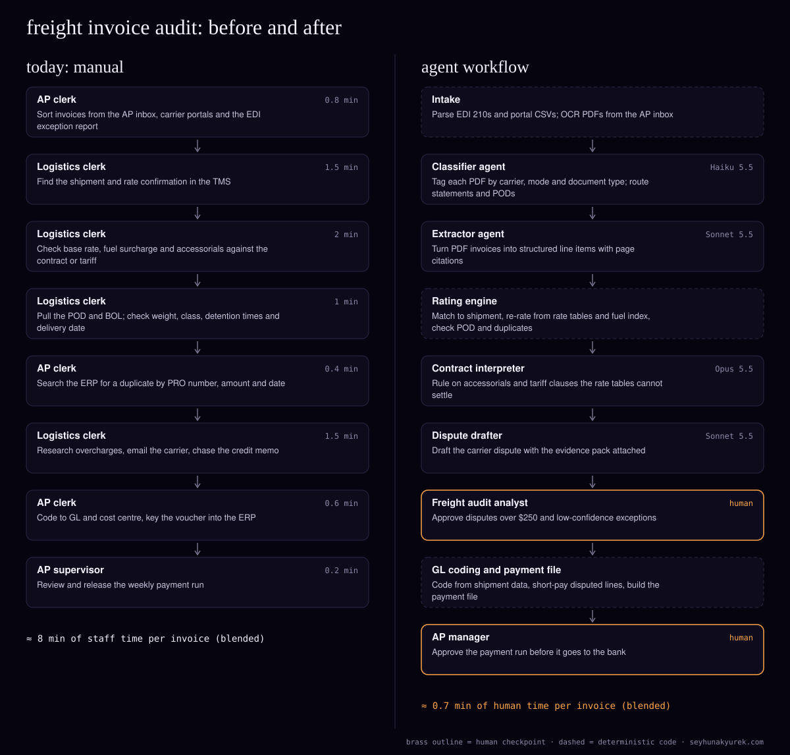

> Also published at https://seyhunakyurek.com/blog/freight-invoice-audit-agent-workflow

Freight invoice audit is the job nobody budgets for until the leakage shows up. A carrier bills a liftgate nobody used, a reweigh that moved the shipment up two classes, detention past a free-time window nobody checked, or the same invoice twice: once by EDI and once as a PDF. Each error is small. Across a year they add up, and the people who catch them are AP and logistics clerks working a queue by hand.

The firm here is a mid-sized US shipper or 3PL receiving about 25,000 carrier invoices a month across LTL, truckload, parcel and ocean. They arrive as EDI 210, as carrier portal exports, and as PDFs in an AP inbox. The team matches each one to the rate confirmation, the contract or tariff and the proof of delivery, codes it to the GL, and disputes what is wrong.

Most of that is arithmetic against tables, so most of the redesign is plain code. The models only do what code cannot: read messy PDFs, interpret contract language, and write disputes.

The firm here is a composite: the volumes are typical for the segment, and every cost below is computed from Claude API list prices on 10 November 2026.

## the process today

| step | who | minutes |
|---|---|---|
| Sort invoices from the AP inbox, carrier portals and the EDI exception report | AP clerk | 0.8 |
| Find the shipment and rate confirmation in the TMS | Logistics clerk | 1.5 |
| Check base rate, fuel surcharge and accessorials against the contract or tariff | Logistics clerk | 2.0 |
| Pull the POD and BOL; check weight, class, detention and delivery date | Logistics clerk | 1.0 |
| Search the ERP for a duplicate by PRO number, amount and date | AP clerk | 0.4 |
| Research overcharges, email the carrier, chase the credit memo | Logistics clerk | 1.5 |
| Code to GL and cost centre, key the voucher | AP clerk | 0.6 |
| Release the weekly payment run | AP supervisor | 0.2 |
| **Total per invoice (blended)** | | **8.0** |

These are blended averages. A clean EDI invoice takes two minutes; an ocean invoice with demurrage and chassis charges can take twenty. The dispute line is about 6% of invoices at 25 minutes each, spread across all of them. At 25,000 invoices that is about 3,333 hours a month, or 20 people. Few teams have 20 people for this, so they audit the big invoices and wave the small ones through. That is where the leakage lives.

The time goes into lookups across the TMS (Oracle OTM, Blue Yonder, MercuryGate or similar), the contract files, and the ERP (SAP, Oracle, NetSuite or Dynamics). The errors come from the same place: fuel surcharges depend on a weekly diesel index, accessorial rules sit in tariff PDFs, duplicates slip through when one invoice arrives by EDI and by email, and disputes stall because building the evidence takes longer than the clerk has.

## the agent architecture

The pattern is a pipeline with a router after rating. Every invoice goes through intake, normalisation and the rating engine in the same order; the router then sends it to auto-approval, contract interpretation, or dispute. I chose a pipeline over an orchestrator because the order never changes. An orchestrating LLM would add cost and a failure mode without adding a decision.

EDI parsing, portal mapping, OCR, re-rating, fuel calculation, duplicate detection, POD matching, GL coding and the payment file are all ordinary code. A rate table lookup should be right every time, and code is.

### intake (deterministic)

EDI 210s come from the VAN or AS2 and go through a standard X12 parser. Portal exports arrive by SFTP or API and are mapped per carrier. PDFs are run through an OCR service (AWS Textract, Azure Document Intelligence or Google Document AI). About 45% of invoices are EDI, 20% portal CSV and 35% PDF. Only the PDFs touch an LLM before rating.

### classifier agent

- **Job:** label each PDF by carrier, mode and document type (invoice, statement, credit memo, POD). Non-invoices are filed against their shipment.
- **Model:** Haiku 5.5. It is classification over one page of OCR text, 8,750 times a month.
- **Inputs and outputs:** first-page text, sender, the carrier master; returns a label and a confidence score. No tools.
- **Guardrails:** the carrier must match the master by SCAC or name; under 0.9 confidence goes to manual triage. It runs in real time so ocean invoices with short dispute windows are routed the same day.

### extractor agent

- **Job:** turn a PDF into the same record the EDI parser produces: PRO number, references, lane, weight, class, line items with charge codes, totals.
- **Model:** Sonnet 5.5. Freight invoices have no standard layout and line items wrap across pages. That is extraction with some judgement, the Sonnet tier's job.
- **Inputs and outputs:** OCR text with coordinates, page images where OCR scored poorly, and a cached schema and charge-code map; returns the record with a page citation and confidence per field. No tools; it never touches the ERP.
- **Guardrails:** code checks that line items sum to the total and the PRO matches the carrier's pattern. A failure is retried once with the error, then goes to the analyst.

### rating engine (deterministic)

The core of the audit is plain code. It matches the invoice to the TMS shipment, re-rates it from the contracted tables (lane rate, weight break or zone, minimum, discount), recalculates fuel from the carrier's fuel table and the weekly diesel price, checks the POD, and looks for duplicates across every channel by shipment, amount and date. Variances inside a tolerance ($5 or 0.5%, whichever is larger) auto-approve. Priced accessorials are rated directly. Everything else goes to the contract interpreter.

### contract interpreter agent

- **Job:** decide whether a charge the tables could not settle is billable. Typical cases: detention with conditional free time, reclass after inspection, limited-access fees, ocean demurrage against free days, accessorials the contract mentions but does not price.
- **Model:** Opus 5.5. This is the judgement step, and a wrong call either pays an overcharge or opens a dispute that strains a carrier relationship. It runs on about 12% of invoices, so the top tier is affordable.
- **Inputs:** the variance, the shipment facts, contract and tariff clauses retrieved by section, and a cached audit rulebook with the firm's policy per accessorial.
- **Outputs:** billable, not billable, partial, or ambiguous, with the expected amount, the quoted clause and a confidence score.
- **Tools:** read-only retrieval over the contract store, and read-only POD and telematics timestamps where the TMS has them.
- **Guardrails:** code checks that the quoted clause exists and was in force on the ship date. "Ambiguous" always goes to a person. The agent cannot approve or dispute anything.

### dispute drafter agent

- **Job:** write the carrier dispute for each not-billable or partial ruling.
- **Model:** Sonnet 5.5. Drafting from structured facts is well within its range.
- **Inputs and outputs:** the ruling, invoice, shipment, POD and a cached playbook of templates per carrier and charge type; returns the dispute text, the short-pay amount and an evidence list. It writes drafts only; sending is a separate logged action.
- **Guardrails:** code checks the disputed amount equals the ruling. Drafts under $250 go out automatically; drafts at or above $250 wait for the analyst.

### GL coding and payment file (deterministic)

Accounts and cost centres come from a rules table keyed on customer, lane, business unit and mode. About 10% of invoices don't map cleanly; for those a Haiku 5.5 call suggests an account, which the analyst confirms. Approved and short-paid amounts go into the ERP's payment file format.

### human checkpoints

- **Freight audit analyst:** approves disputes of $250 or more, ambiguous rulings, extractions that failed twice, and any variance over $500. They also handle carrier replies.
- **AP manager:** approves every payment run. No money leaves without a person releasing it, which keeps the segregation of duties most control frameworks expect, including SOX for US-listed companies.

Policy rules also escalate: no rate table, a carrier on hold, or a dispute older than 150 days. For US motor carriers, federal law generally gives shippers 180 days to contest charges (49 U.S.C. 13710), so anything near that limit jumps the queue. Check your contracts and counsel for the windows on your modes.

## the exact flow

1. Intake collects EDI, portal exports and PDFs, hashes each document and drops exact duplicates. Parse failures go to a technical queue.
2. PDFs are OCR'd with two retries; persistent failures go to triage.
3. The classifier labels each PDF in real time. Low-confidence labels go to triage.
4. Invoice PDFs join the extractor's evening Batch API job, which typically returns overnight.
5. Code validates each extraction. Failures are resubmitted once with the error, then go to the analyst.
6. The rating engine matches, re-rates and checks POD and duplicates. No shipment match waits 48 hours for the TMS, then escalates.
7. In-tolerance invoices go to GL coding; the rest join the contract interpreter's nightly batch.
8. Rulings with an unverifiable quote are retried once, then marked ambiguous.
9. Billable rulings are approved. Not-billable and partial rulings go to the dispute drafter in the same cycle.
10. Disputes under $250 go out. Larger ones, ambiguous rulings and big variances reach the analyst each morning.
11. GL coding runs on approved invoices; unmapped lines get a Haiku suggestion.
12. The payment file short-pays disputed lines, and the AP manager releases it.
13. Carrier responses are matched to the case. Credit memos close it; rejections return to the analyst.

If a model call or the Batch API is unavailable, invoices wait in the queue and the payment run goes out with what finished. Freight terms are usually 15 to 45 days, so a day's delay costs nothing.

## the api costs

Most of this can wait hours, so the extractor, contract interpreter, dispute drafter and GL fallback all run through the Batch API at 50% off. Only the classifier runs in real time. The cached prefixes (schemas, rulebook, playbook) are stable, and batches are grouped so calls sharing a prefix run together. I assume one cache write per 20 calls. Batch cache hits are best effort, so treat that as a modelling assumption.

Token counts are per call. Cost per unit is the per-call cost times the share of invoices reaching that agent, so the column sums to the cost of an average invoice. Output includes thinking: 500 tokens for the extractor, 2,000 for the contract interpreter.

| agent | model | input tokens | cached input tokens | output tokens | cost per unit |
|---|---|---|---|---|---|
| Classifier (35%, real time) | Haiku 5.5 | 3,000 | 2,000 | 150 | $0.000072 |
| Extractor (35%, batch) | Sonnet 5.5 | 9,000 | 4,000 | 2,000 | $0.005404 |
| GL fallback (10%, batch) | Haiku 5.5 | 2,500 | 2,000 | 200 | $0.000009 |
| Contract interpreter (12%, batch) | Opus 5.5 | 14,000 | 8,000 | 3,200 | $0.005491 |
| Dispute drafter (6%, batch) | Sonnet 5.5 | 7,000 | 3,000 | 1,500 | $0.000710 |
| **Total per invoice** | | | | | **$0.011686** |

The extractor row, worked through: 5,000 uncached input tokens at $2.00 per million is $0.010. The 4,000 cached tokens bill at 95% cache reads ($0.10) and 5% writes ($2.50), an effective $0.22 per million, so $0.00088. The 2,000 output tokens at $10.00 per million are $0.020. That is $0.03088 per call, halved by batching to $0.01544. On 35% of invoices it adds $0.005404 per invoice, or $135.10 a month.

At 25,000 invoices the API bill is **about $292 a month**: contract interpreter $137.28, extractor $135.10, dispute drafter $17.75, classifier $1.81, GL fallback $0.23. Without caching or batching the same workload would cost about $740.

| item | monthly |
|---|---|
| Claude API (all agents) | $292 |
| OCR, about 26,000 pages (estimate) | $40 |
| Hosting: queue, workers, database (estimate) | $300 |
| Document storage (estimate) | $25 |
| Observability and logging (estimate) | $150 |
| **Total running cost** | **$807** |
| Staff time today (8.0 min × 25,000) | 3,333 hours |
| Staff time after (0.73 min × 25,000) | 304 hours |
| **Modelled hours saved** | **3,029 hours** |
| Labour value at $38/hour | $115,100 |

The $38 is a fully loaded US Midwest rate for AP and logistics clerks. The 0.73 minutes is modelled as analyst review on 8% of invoices at 4 minutes, dispute approvals on 3% at 3 minutes, carrier follow-up on 6% at 5 minutes, and 0.02 minutes for the payment run. The table leaves out overcharge recovery. In freight audit that is often the bigger number, but it depends on your carriers, and I won't guess it without your data.

## what it will get wrong

- **A duplicate with a new number.** Carriers rebill with a suffix or new number. Duplicates are matched on shipment and amount, and a rebill is held until a credit memo for the original exists.
- **An expired contract clause.** Code filters retrieval to clauses in force on the ship date, and the quote check fails anything else.
- **Misread weight or class on a scan.** The arithmetic check catches most; the rating engine also compares against the BOL and TMS, and a weight variance over 10% goes to the analyst instead of an automatic dispute.
- **Detention without timestamps.** With no gate or telematics data, the interpreter must answer "ambiguous". The golden set tests that it does instead of guessing.
- **A correct dispute that hurts the relationship.** The model doesn't know a carrier covered a hard lane last month. The $250 threshold and a per-carrier hold flag let the analyst manage that.
- **A stale fuel index.** The engine refuses to rate fuel if the stored index is more than eight days old, and alerts.
- **Instructions hidden in a PDF.** Invoice text is data. No agent can pay, send or write to the ERP, so the worst case is a wrong draft that code or a person catches.

## how you know it works

Build a golden set of 1,500 historical invoices, stratified by format (525 PDF, 675 EDI, 300 portal) and mode, with at least 200 ocean. Include every dispute won in the last year, every known duplicate, and invoices paid and later found wrong. Two clerks label each outcome independently and settle disagreements before testing.

The bar for go-live:

- **Extraction accuracy:** 99% on amounts, PRO numbers and dates; 97% on other fields.
- **Overcharge recall:** at least 95% of historically won disputes flagged.
- **False dispute rate:** under 3% of drafts judged unjustified by a reviewer.
- **Duplicate detection:** 100% of seeded duplicates. Pass or fail.
- **Ruling agreement:** 90% with reviewers, and every reviewer-marked ambiguous case escalated.
- **Escalation rate:** 15% or fewer invoices reach a person, falling toward 10%.
- **Cycle time:** 95% of invoices payment-ready within 48 hours of receipt.

After go-live, analyst decisions feed the golden set monthly, and it is re-run after any prompt or model change.

## the build plan

- **Week 1:** map carriers, formats and agreements. Load rate and fuel tables for the top 20 carriers. Pull the golden set.
- **Week 2:** intake: EDI 210 parser, portal mappings, OCR, the canonical record.
- **Week 3:** rating engine and duplicate detection, tested on EDI alone with no LLM.
- **Week 4:** classifier and extractor, tuned on the PDF golden set.
- **Week 5:** contract interpreter with rulebook and clause retrieval; review every golden-set ruling with the analyst.
- **Week 6:** dispute drafter, playbook and review queue; GL coding and payment file in a test ERP company.
- **Week 7:** shadow mode on live invoices, compared daily with the team's outcomes.
- **Week 8:** live for EDI and portal invoices from the top 20 carriers, with every dispute approved by the analyst.
- **Week 9:** add PDFs and remaining carriers. Move to the $250 threshold once false disputes hold under 3% for two weeks.
- **Week 10:** handover: runbook, dashboards, monthly golden-set runs, and the process for loading new contracts.

## run your own numbers

The [AI token cost estimator](https://seyhunakyurek.com/tools/ai-token-cost-estimator?model=claude-sonnet-5-5&requests=24500&input=6684&output=1272&cached=53&batch=64) is pre-filled with this workload averaged across agents: 24,500 calls a month, 6,684 input and 1,272 output tokens per call, 53% of input cached, 64% of calls batched. It prices every call at Sonnet 5.5, so it reads higher than the mixed-model table above.

To check whether your accuracy evidence is strong enough for a controller to sign off, use the [AI accuracy proof calculator](https://seyhunakyurek.com/tools/ai-accuracy-proof-calculator).

If you want this mapped to your carriers, contracts and ERP, [book a 20-minute call](https://seyhunakyurek.com/contact).
