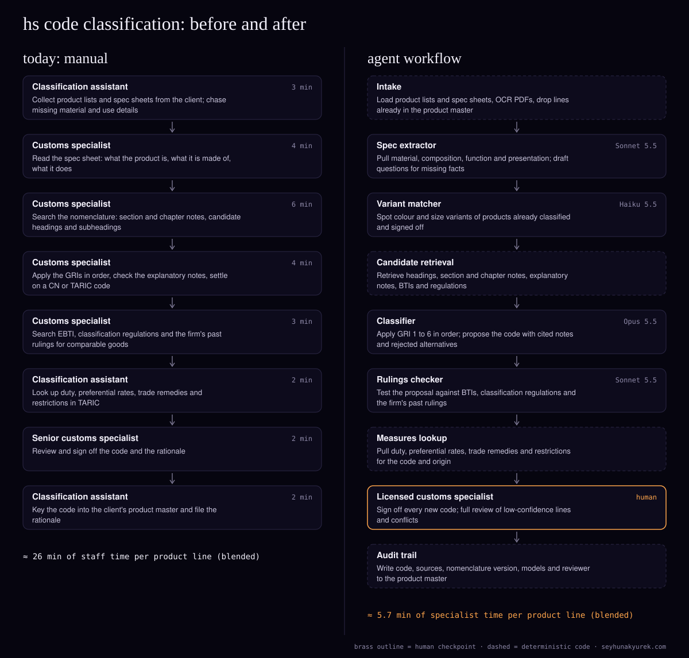

> Also published at https://seyhunakyurek.com/blog/hs-code-classification-agent-workflow

Every product that crosses a border needs a tariff code, and the code decides almost everything after it: the duty rate, any anti-dumping duty, the licences needed, and whether a preferential origin claim holds. A wrong code is quiet at first. The goods clear, and the error surfaces in a post-clearance audit as a duty bill for every shipment since.

The people who carry this are classification specialists at customs brokers and in importers' trade compliance teams. The firm here is a mid-size customs broker in the Netherlands acting for importers of consumer goods, machinery parts and household products. It classifies about 3,000 new product lines a month. About 40% are colour or size variants of products already classified. The rest need a specialist to read a spec sheet, work through the nomenclature and defend the answer.

Classification is judgement over a long, structured reference text. That makes it a good fit for a model that can read notes and rulings carefully, and a bad fit for one that is allowed to decide alone.

The firm here is a composite: the volumes are typical for the segment, and every cost below is computed from Claude API list prices on 10 November 2026.

## the process today

| step | who | minutes |
|---|---|---|
| Collect product lists and spec sheets from the client; chase missing material and use details | Classification assistant | 3 |
| Read the spec sheet: what the product is, what it is made of, what it does | Customs specialist | 4 |
| Search the nomenclature: section and chapter notes, candidate headings and subheadings | Customs specialist | 6 |
| Apply the GRIs in order, check the explanatory notes, settle on a CN or TARIC code | Customs specialist | 4 |
| Search EBTI, classification regulations and the firm's past rulings for comparable goods | Customs specialist | 3 |
| Look up duty, preferential rates, trade remedies and restrictions in TARIC | Classification assistant | 2 |
| Review and sign off the code and the rationale | Senior customs specialist | 2 |
| Key the code into the client's product master and file the rationale | Classification assistant | 2 |
| **Total per product line (blended)** | | **26** |

These are blended averages. A blue variant of a red kettle on file takes three minutes; a multi-function device or a retail set can take an hour. At 3,000 lines a month the blend is 1,300 hours, or about nine people.

The time goes into reading and searching. The Harmonized System fixes the first six digits worldwide; the EU's Combined Nomenclature adds two, and TARIC adds two more where EU measures need them. Behind each code sit section and chapter notes, the WCO's HS Explanatory Notes, the CN Explanatory Notes, Commission classification regulations and thousands of binding tariff information (BTI) decisions. The errors come from the same place: an unread chapter note that excludes the product, essential character decided on price, a code copied from a supplier's invoice, or a BTI for a product that differs on the one feature that mattered. Suppliers' spec sheets describe what sells, not what classifies.

## the agent architecture

The pattern is a pipeline with a router after the variant matcher. Variants go straight to the specialist with the parent product's code; everything else goes through retrieval, the classifier and the rulings checker. I chose a pipeline over an orchestrator because the method fixes the order: you can't apply the GRIs before you know what the product is made of.

Intake, OCR, de-duplication against the product master, candidate retrieval, the measures lookup and the audit trail are ordinary code. Nothing an LLM produces is written to a system of record until a person signs it off.

### intake (deterministic)

Clients send product lists as spreadsheets or ERP exports, with spec sheets and photos as PDFs. Intake maps each client's columns to a canonical line, runs PDFs through an OCR service (AWS Textract, Azure Document Intelligence or Google Document AI), and drops SKUs already in the product master. A supplier's HS code is kept only as a labelled hint.

### spec extractor agent

- **Job:** turn a product line and its documents into the facts classification needs: material and composition by weight, function and principal use, form and state, how it is powered, how it is put up (single item, set, kit, retail packaging), and whether it is a part or accessory of something else.
- **Model:** Sonnet 5.5. Extraction across messy documents, with some judgement about the principal function.
- **Inputs and outputs:** the canonical line, OCR text and page images where OCR scored poorly, and a cached attribute schema per product family. It returns structured attributes, each with a source citation and a confidence score, plus a list of missing facts written as questions to the client.
- **Tools and guardrails:** no tools. Code checks that compositions sum to 100% and that every attribute cites a source. A line missing a critical fact (fibre content for textiles, say) is held and the question goes to the client. About 15% of lines need one round, and the extractor runs again on the answer.

### variant matcher agent

- **Job:** decide whether a new line is a variant of a product already classified and signed off, differing only in colour, size or another feature that does not change the code.
- **Model:** Haiku 5.5. Comparing short attribute sets against a fixed feature list is classification, and it runs on every line.
- **Inputs and outputs:** the new line's attributes and the five nearest classified products from the product master, found by code; returns a match, the parent product and a confidence score.
- **Guardrails:** a match needs 0.9 confidence and identical values on every classification-relevant attribute; anything else goes the long way. The specialist still confirms each variant.

### candidate retrieval (deterministic)

This is search, not a model. The nomenclature is loaded as versioned structured data, every line with its notes and explanatory notes attached. Keyword search plus an embedding index returns the top candidate headings across chapters, their notes, explanatory note extracts, and the closest BTIs from the European Commission's EBTI database and classification regulations. It always attaches the chapter notes for every candidate, because exclusion notes are where most errors live.

Why not load the whole tariff? With its notes and explanatory notes it is far beyond any sensible prompt. A single chapter fits, though, and when a client sends 200 apparel lines from chapters 61 and 62, caching those chapters for the batch beats retrieving per line. Retrieval is the default; chapter caching is the optimisation.

### classifier agent

- **Job:** apply the General Rules of Interpretation in order and propose a code. GRI 1 first (the headings and the section and chapter notes), then GRI 2 for incomplete goods and mixtures, GRI 3 for goods under two or more headings (most specific, then essential character, then last in numerical order), GRI 4 and 5 where needed, and GRI 6 down to the subheading. Then the CN and TARIC levels.
- **Model:** Opus 5.5. This is the judgement step, and a wrong answer costs real money in back duty. It runs on the 60% of lines that are not variants, so the top tier is affordable.
- **Inputs:** the extracted attributes, the retrieved candidates with their notes, and a cached prompt with the GRI method, the firm's classification policy and the output format.
- **Outputs:** the code, the GRI path, every note relied on (quoted), the rejected alternatives and why, a confidence score, and the facts the answer depends on ("if the shell is over 50% polyurethane by weight, the code changes").
- **Tools:** read-only retrieval, so it can pull a chapter it was not given.
- **Guardrails:** code checks that every quoted note exists word for word in the nomenclature in force and that the code is a valid end line. A failure is retried once, then escalated. The agent can't write a code anywhere.

### rulings checker agent

- **Job:** challenge the classifier against the nearest BTIs, classification regulations and the firm's own signed-off rulings; report agreement, conflict, or no close precedent.
- **Model:** Sonnet 5.5. Finding the feature that differs from a ruling is careful reading, not open judgement.
- **Inputs and outputs:** the classifier's output, the product attributes and up to ten retrieved rulings; returns a verdict per ruling with the distinguishing feature named.
- **Guardrails:** a conflict with a classification regulation always escalates. A BTI binds only its holder and the authorities for the goods it describes, so someone else's BTI is evidence, not an answer.

### measures lookup (deterministic)

Code pulls the measures for the proposed code from TARIC data (the Commission's published data or a commercial feed): third-country duty, preferential rates for the client's origins, anti-dumping and countervailing duties, quotas, and restrictions such as licences. It flags goods in scope of CBAM, which is defined by CN code, and pulls the product-specific origin rule where a preference is claimed. Many of those rules are written as a change of tariff heading, so a wrong heading can break an origin claim too. It is a lookup, and it is either right or stale.

### human checkpoint

A licensed customs specialist signs off every new code. EU law does not create a single EU-wide broker licence; some member states license or certify customs representatives, and under the Union Customs Code applicants for AEO status for customs simplifications must show practical standards of competence or professional qualifications. Use whichever qualification your authority and your firm's procedures recognise.

The depth of review depends on what the pipeline found:

- **Variants (about 40% of lines):** confirm the parent code in about a minute.
- **High confidence, no conflicting ruling (about 36%):** read the rationale and quoted notes, about four minutes.
- **Low confidence, conflicting rulings, or high duty exposure (about 24%):** full review, about fifteen minutes. The triggers are confidence under 0.85, any conflict with a BTI or classification regulation, a candidate subject to anti-dumping duty, a duty difference over five percentage points between the top two candidates, or a client-defined value threshold.

For high-exposure lines the specialist can recommend that the client apply for its own BTI. Under the Union Customs Code a BTI is generally valid for three years and binds both the authorities and the holder; applications go through the EU Customs Trader Portal in most member states. The workflow does not replace that. And where the broker acts as an indirect representative, it is generally jointly liable for the customs debt, which is why sign-off stays with a person.

### audit trail (deterministic)

Every signed-off line writes to the product master and an append-only log: code, GRI path, quoted notes and rulings, nomenclature version, model and prompt versions, every agent output, and the specialist's name and edits. When the CN is updated (published each autumn, applying from 1 January) or the HS changes, code re-queues every product whose code or notes changed.

## the exact flow

1. Intake loads lists and documents, OCRs PDFs with two retries, and drops lines already classified. Unreadable files go to the assistant.
2. The spec extractor runs in the nightly Batch API job; rush lines, about 15%, run in real time. Code validates each extraction; failures are retried once with the error, then go to the assistant.
3. Lines missing a critical fact are held, and the drafted question goes to the client. When the answer arrives, the extractor runs again.
4. The variant matcher runs in real time. Matches go to the specialist queue with the parent code.
5. For other lines, retrieval assembles candidates, notes, explanatory notes and rulings.
6. The classifier proposes a code in the batch job. A failed quote or invalid code is retried once, then escalated.
7. The rulings checker tests the proposal against precedent in the same cycle.
8. The measures lookup pulls duty, trade remedies, restrictions and origin rules for the proposed code and its runner-up.
9. The router sets the review depth from confidence, conflicts and exposure, and the line reaches the specialist the next morning.
10. The specialist approves, edits or rejects. An edit records the reason, and the line goes to the golden set.
11. Approved codes are written to the product master with the full rationale, and the client is notified.
12. Each January, and on any classification regulation or HS amendment, affected products are re-queued.

If the API is unavailable, lines wait. New SKUs are usually classified well before the first shipment, and rush lines fall back to a specialist working alone.

## the api costs

Most lines can wait hours, so the extractor, classifier and rulings checker use the Batch API at 50% off for the 85% of lines that aren't rush. The variant matcher runs in real time. The cached prefixes (schemas, the GRI method and policy, the checker's instructions) are stable, and calls sharing a prefix are grouped. I assume one cache write per 20 calls; batch cache hits are best effort, so that is a modelling assumption.

Token counts are per call. Cost per unit is the per-call cost times the calls per line, so the column sums to the cost of an average product line. Output includes thinking: 400 tokens for the extractor, 2,500 for the classifier.

| agent | model | input tokens | cached input tokens | output tokens | cost per unit |
|---|---|---|---|---|---|
| Spec extractor (1.15 calls, 85% batch) | Sonnet 5.5 | 6,000 | 3,000 | 1,200 | $0.016306 |
| Variant matcher (1 call, real time) | Haiku 5.5 | 2,500 | 1,500 | 200 | $0.000374 |
| Classifier (0.66 calls incl. retries, 85% batch) | Opus 5.5 | 18,000 | 6,000 | 4,000 | $0.058686 |
| Rulings checker (0.6 calls, 85% batch) | Sonnet 5.5 | 10,000 | 2,000 | 800 | $0.009812 |
| **Total per product line** | | | | | **$0.085178** |

The classifier row, worked through: 18,000 uncached input tokens at $4.00 per million is $0.072. The 6,000 cached tokens bill at 95% cache reads ($0.20) and 5% writes ($5.00), an effective $0.44 per million, so $0.00264. The 4,000 output tokens at $20.00 per million are $0.080. That is $0.15464 per call. With 85% of calls batched at half price, the average call costs $0.15464 × 0.575 = $0.088918. At 0.66 calls per line (60% of lines, plus 10% retries) that is $0.058686 per line, or $176.06 a month.

At 3,000 lines the API bill is **$255.53 a month**, about 8.5 cents a line: classifier about $176, extractor about $49, rulings checker about $29, variant matcher about $1. Without caching or batching the same workload would cost about $511.

| item | monthly |
|---|---|
| Claude API (all agents) | $255.53 |
| Tariff and rulings data feed (estimate) | $400 |
| Hosting: queue, workers, database, search index (estimate) | $300 |
| Embeddings for the nomenclature and rulings index (estimate) | $50 |
| OCR for spec sheets (estimate) | $30 |
| Document storage (estimate) | $25 |
| Observability and logging (estimate) | $150 |
| **Total running cost** | **$1,210.53** |
| Staff time today (26 min × 3,000) | 1,300 hours |
| Staff time after (5.74 min × 3,000) | 287 hours |
| **Modelled hours saved** | **1,013 hours** |
| Labour value at $55/hour | $55,715 |

The $55 is my assumed blended, fully loaded rate for classification specialists and assistants in the Netherlands. The 5.74 minutes is 40% × 1 for variants, 36% × 4 for high-confidence lines, 24% × 15 for full reviews, and 15% × 2 for handling client questions. The hours are capacity, not a headcount plan, and the table leaves out the larger number: duty avoided on errors that never happen, and back-duty assessments that never arrive. That depends on your clients' goods and duty rates, and I won't guess it without your data.

## what it will get wrong

- **A chapter note that excludes the product.** The classical error. Retrieval always attaches the notes for every candidate heading, the classifier must state which exclusions it checked, and the golden set seeds products that a chapter note excludes.
- **Essential character on the wrong basis.** Sets tempt any classifier to go by value. The policy lists the factors (bulk, weight, value, role in use), and every GRI 3(b) decision gets full review.
- **A spec sheet that describes marketing, not the product.** "Premium leather-look" is not leather. The extractor must cite a source for every material, and an uncited composition holds the line for a client question.
- **A BTI for a product that isn't quite the same.** The checker has to name the distinguishing feature, and a BTI issued to someone else never settles a line on its own.
- **A code that no longer exists.** Codes change every January. Proposals are validated against the nomenclature in force, and the January re-queue catches the product master.
- **Automation bias.** A specialist approving 600 lines a month will start to skim. Override rates per specialist are tracked, and seeded lines with known answers go into the queue every week.
- **Instructions hidden in a spec sheet.** Document text is data. No agent can write a code, file a declaration or contact a client, so the worst case is a wrong proposal that code or a person catches.

## how you know it works

Build a golden set of 1,000 signed-off product lines, stratified by chapter and difficulty: at least 150 variants, 150 GRI 3 decisions, 100 parts and accessories, 100 sets, every line later corrected after an audit, and lines covered by a BTI or classification regulation. Two senior specialists re-check 200 of them independently, because the history is not all right.

The bar for go-live:

- **Field-level accuracy** of extracted attributes: 98% on material and composition, 97% on function and presentation.
- **Code accuracy:** 99% at heading (4 digits) and 95% at the full CN code on non-variant lines that were not escalated.
- **Precedent agreement:** 100% on lines covered by a classification regulation. Pass or fail.
- **Variant precision:** 99.5%. A false variant skips the full path, so this bar is high.
- **Escalation recall:** every golden-set line the reviewers marked as genuinely ambiguous goes to full review.
- **Escalation rate:** 30% or fewer of non-variant lines go to full review, falling over time.
- **Cycle time:** 95% of non-rush lines ready for sign-off within one business day of a complete spec sheet.

After go-live, every specialist edit feeds the golden set, and it is re-run after any prompt, model or nomenclature change.

## the build plan

- **Week 1:** agree scope with the head of classification: chapters, clients, review tiers and thresholds. Pull the golden set and the product master.
- **Week 2:** load the nomenclature, notes and explanatory notes as versioned data; build intake and column mapping for the top ten clients.
- **Week 3:** candidate retrieval and the rulings index, tested on the golden set alone. Retrieval recall at heading level is measured before any model sees it.
- **Week 4:** spec extractor and the client question flow.
- **Week 5:** variant matcher and classifier; review every golden-set disagreement with a senior specialist.
- **Week 6:** rulings checker, measures lookup, the review queue screen and the audit log.
- **Week 7:** full golden-set evaluation; tune thresholds; write the procedure that documents the specialist's role.
- **Week 8:** shadow mode on live lines, compared daily with the team's own codes.
- **Week 9:** live for two clients with every line on full review.
- **Week 10:** move to tiered review once the bars hold for two weeks; hand over the runbook, dashboards and the January re-queue process.

## run your own numbers

The [AI token cost estimator](https://seyhunakyurek.com/tools/ai-token-cost-estimator?model=claude-sonnet-5-5&requests=10230&input=10965&output=1378&cached=27&batch=60) is pre-filled with this workload averaged across agents: 10,230 calls a month, 10,965 input and 1,378 output tokens per call, 27% of input cached, 60% of calls batched. It prices every call at Sonnet 5.5, so it reads lower than the mixed-model table above, where the Opus classifier dominates.

A tariff is a classic long reference document. The [RAG vs long-context calculator](https://seyhunakyurek.com/tools/rag-vs-long-context-calculator) shows when retrieving headings per line beats caching a whole chapter, which usually comes down to how many lines from the same chapter arrive together.

To check whether your golden-set results are strong enough for a head of classification to sign off on tiered review, use the [AI accuracy proof calculator](https://seyhunakyurek.com/tools/ai-accuracy-proof-calculator).

If you want this mapped onto your clients, chapters and product master, [book a 20-minute call](https://seyhunakyurek.com/contact).
