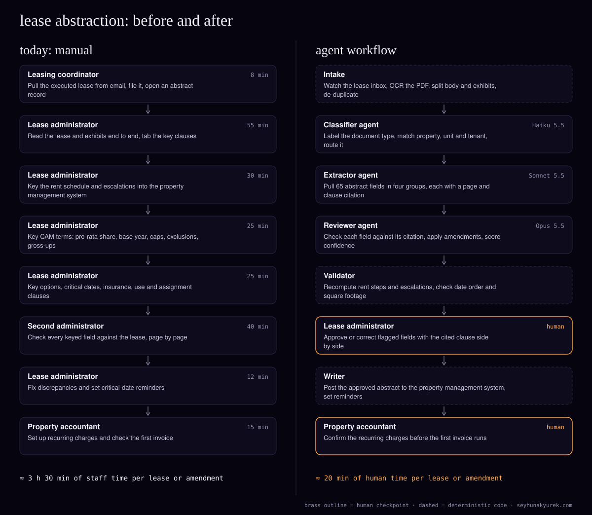

> Also published at https://seyhunakyurek.com/blog/lease-abstraction-agent-workflow

Every commercial lease that gets signed has to be turned into data before anyone can bill against it. Someone reads a 40 to 120 page PDF, finds the rent schedule, the escalations, the CAM terms, the renewal and termination options and the critical dates, and types 50 to 80 fields into the property management system. Then a second person checks all of it.

This post looks at a mid-sized property manager with about 4,000 commercial units. It takes in about 120 new leases and amendments a month. That is roughly 420 hours of skilled lease administration every month, most of it spent reading and retyping. The real cost is the errors that slip through: a missed escalation or a wrong CAM cap leaks money for years.

I mapped the manual process, then designed the agent workflow I would build to replace the reading and typing while keeping a person on every number that matters.

The firm here is a composite: the volumes are typical for the segment, and every cost below is computed from Claude API list prices on 10 November 2026.

## the process today

The minutes below are blended averages across new leases and amendments. A 110-page anchor lease takes far longer than a two-page extension, but the mix evens out.

| step | who | minutes |
|---|---|---|
| Pull the executed lease from email, file it, open an abstract record | Leasing coordinator | 8 |
| Read the lease and exhibits end to end, tab the key clauses | Lease administrator | 55 |
| Key the rent schedule and escalations | Lease administrator | 30 |
| Key CAM terms: pro-rata share, base year, caps, exclusions, gross-ups | Lease administrator | 25 |
| Key options, critical dates, insurance, use and assignment clauses | Lease administrator | 25 |
| Check every keyed field against the lease | Second administrator | 40 |
| Fix discrepancies and set critical-date reminders | Lease administrator | 12 |
| Set up recurring charges and check the first invoice | Property accountant | 15 |
| **total** | | **210** |

The time goes into finding things, not typing them. Leases don't put terms where you expect. The rent table is in an exhibit, the escalation is a percentage in section 4, and a later rider changes the first year anyway. CAM language is the worst: the cap might be cumulative or non-cumulative, apply to controllable expenses only, and exclude a list of items that runs for two pages. Errors come from three places. A clause gets missed because it sits in an exhibit or a rider. An amendment changes a term but the old value stays in the system. Or the arithmetic is wrong when a percentage escalation is turned into a dollar schedule by hand. The second check catches many of these, but the checker reads the same way the first person did, so the misses tend to overlap.

## the agent architecture

The workflow is a pipeline: every lease goes through the same stages in the same order, and each stage has one job. I chose a pipeline over an orchestrator with workers because the process barely branches. The only fork is "new lease or amendment", and that is a flag the reviewer reads, not a different path. A pipeline is easier to test and to replay when something fails, and every stage leaves a record you can inspect.

Three of the steps are deterministic code, not an LLM: intake and OCR, the validator, and the writer. The models only do the reading and the judgement.

### intake (deterministic code)

It watches the lease inbox and the document store, runs OCR on scanned PDFs, keeps page numbers, and splits the body from exhibits and riders. It hashes each file so a lease sent twice is processed once.

- Inputs and outputs: PDFs in; page text with layout markers, an exhibit index and a document ID out.
- Tools: an OCR service and the document store API.
- Guardrails: a page below the OCR confidence threshold sends the lease to a person. No model guesses at a smudged rent table.

### classifier agent (Haiku 5.5)

It labels the document (new lease, amendment, assignment, renewal, estoppel, or not a lease) and matches property, suite and tenant.

- Model: Haiku 5.5, because this is classification and lookup, and it costs a fraction of a cent.
- Inputs and outputs: the first three pages and the file name in; document type, property, unit and tenant IDs and a confidence score out.
- Tools: a read-only lookup against the property and tenant tables.
- Guardrails: no match or a double match sends the lease to the coordinator's queue.

### extractor agent (Sonnet 5.5)

It pulls the abstract in four calls, one per field group: rent and escalations; CAM and recoveries; options and critical dates; everything else (use, assignment, insurance, deposit, guarantor). Every field comes back with a page number and the exact clause text.

- Model: Sonnet 5.5. Structured extraction from long documents is what the middle tier does well. Opus would cost twice as much and isn't better at copying a number out of a table.
- Inputs and outputs: the lease text and the field schema in; JSON for 65 fields, each with a value, a citation or "not found", out. The document and schema sit in a cached prefix, so the first call writes the cache and the next three read it.
- Tools: none. It reads; it doesn't act.
- Guardrails: a field without a citation counts as empty. Dates must be ISO and money must be numbers, so the validator can check them.

### reviewer agent (Opus 5.5)

Its job is to doubt the extractor. It sees each field next to the clause it cites and asks whether the clause says that. For amendments it also loads the current abstract and decides which terms are replaced, added or left alone. That is the judgement-heavy part of abstraction, and where errors cost most.

- Model: Opus 5.5. Reading "the Base Rent set forth in Section 4.1 shall be amended as follows, except as provided in Exhibit C" correctly is a reasoning problem. This is the only step on the top tier.
- Inputs and outputs: extracted fields, cited passages, the current abstract and the firm's abstraction policy in; a confidence score and reason per field, and the merged abstract for amendments, out.
- Tools: none.
- Guardrails: it can lower confidence or propose a correction, but it can't write anything.

### validator, writer and summary

The **validator** is code. It recomputes every rent step from the base rent and escalation rule, checks that dates are in order and option notice windows fall inside the term, and compares square footage and pro-rata share with the unit and building records. These checks have one right answer, so no model does them.

The **writer** is code. After a person approves, it posts the abstract to the property management system (Yardi, MRI or AppFolio, through whatever API or import format the firm's version supports), creates critical-date reminders and attaches the citation record to the lease file.

The **summary agent** is a Haiku 5.5 call that writes a one-page plain-language summary for the asset manager. Nobody needs it within the hour, so it runs overnight through the Batch API.

### where the human checkpoints sit

There are two. The lease administrator approves every abstract in a review screen, field on the left and cited clause on the right, before anything reaches the property management system. The property accountant confirms recurring charges before the first invoice. A field is flagged when:

- the reviewer's confidence is below 0.9;
- the validator's recomputed number differs from the extracted one;
- the field is financial (base rent, escalation, CAM cap, deposit) and worth more than $250,000 a year;
- the document is an amendment that changes rent or term;
- a field the firm's policy requires came back "not found".

The whole lease escalates to a senior administrator when more than 15 fields are flagged, when OCR failed on a page with a rent table, or when the lease uses a structure the schema doesn't cover, such as percentage rent with a natural breakpoint.

## the exact flow

1. A signed lease lands in the inbox or document store. Intake picks it up within five minutes and skips it if the hash is known.
2. Intake runs OCR and splits body, exhibits and riders. A page below the OCR threshold stops the lease and sends it to the coordinator with the bad pages marked.
3. The classifier labels the document and matches property, unit and tenant. No match or two matches go to the coordinator's queue.
4. The extractor makes four calls against the cached document. A failed call or invalid JSON is retried twice with the validation error attached. A third failure marks that field group "manual" and the lease carries on.
5. The reviewer checks every field against its citation and, for amendments, produces the merged abstract.
6. The validator recomputes rent steps, dates and square footage and adds its own flags.
7. Each flagged field gets one targeted re-ask to the extractor with the disagreement attached. If they still disagree, it stays flagged.
8. The administrator works the review queue, flagged fields first. Corrections are logged for the golden set.
9. On approval, the writer posts to the property management system as one transaction, retrying with backoff and alerting the administrator after the third failure. Nothing is half-written.
10. The writer sets critical-date reminders and attaches the citation record.
11. The accountant confirms recurring charges before the first invoice.
12. Overnight, the summary agent runs through the Batch API.

## the api costs

Assumptions for one lease or amendment: about 75 pages on average including exhibits, which is about 45,000 tokens of text after OCR. The extraction schema and instructions add 6,000 tokens. Thinking tokens are billed as output, so each output figure includes an allowance for them.

| agent | model | input tokens | cached input tokens | output tokens | cost per unit |
|---|---|---|---|---|---|
| Classifier | Haiku 5.5 | 4,000 | 0 | 200 | $0.0005 |
| Extractor (4 calls) | Sonnet 5.5 | 6,000 | 153,000 | 18,000 | $0.3348 |
| Reviewer | Opus 5.5 | 29,000 | 0 | 8,000 | $0.2760 |
| Summary (Batch API) | Haiku 5.5 | 14,000 | 0 | 1,200 | $0.0010 |
| Retries and re-asks (10% of extractor and reviewer) | Sonnet / Opus | | | | $0.0611 |
| **total per lease** | | | | | **$0.6734** |

The extractor's cost includes one cache write per lease, which the input columns don't show. Here is that row worked through. The first call writes 51,000 tokens to the cache at $2.50 per million: $0.1275. The next three calls each read the same 51,000 tokens from cache, 153,000 in total at $0.10 per million: $0.0153. Each of the four calls also sends 1,500 tokens of group-specific instructions, 6,000 in total at $2 per million: $0.0120. The four calls produce 18,000 output tokens, including about 2,000 tokens of thinking each, at $10 per million: $0.1800. That adds up to $0.3348.

I don't cache the classifier or reviewer prompts. At about six leases a working day, the five-minute cache would expire between leases, so a write would cost more than it saves. Caching pays inside a lease, where the same document is read four times in a minute.

The Batch API applies only to the summary agent. Extraction and review could wait hours, but the point is that a lease signed in the morning is abstracted the same day.

At 120 leases a month, the monthly API cost is $0.6734 × 120 = **$80.81**. By agent, that is $0.06 for the classifier, $40.18 for the extractor, $33.12 for the reviewer, $0.12 for the summary and $7.33 for retries.

| item | monthly |
|---|---|
| Claude API | $80.81 |
| OCR, about 9,000 pages (estimate at $1.50 per 1,000 pages) | $13.50 |
| Hosting for the pipeline and review screen (estimate) | $60.00 |
| Document and audit-trail storage (estimate) | $10.00 |
| Observability and LLM tracing (estimate) | $50.00 |
| **total running cost** | **$214.31** |
| Modelled staff time today (210 min × 120) | 420 hours |
| Modelled staff time with the workflow (20 min × 120) | 40 hours |
| **modelled hours saved** | **380 hours** |
| Labour value at $45 an hour (US lease administrator, fully loaded) | $17,100 |

The labour rate is an assumption for a US lease administrator including benefits; use your own. The 20 minutes is 15 minutes of administrator review plus 5 of accountant confirmation. The hours saved are capacity, not headcount. The API is the smallest line here; the real costs are the build and the first two months of tuning.

## what it will get wrong

- **Rent tables in scanned exhibits.** A skewed scan or a handwritten change in an exhibit table will OCR badly. The intake confidence check stops the lease, and the validator catches rent steps that don't follow the escalation rule.
- **Amendments that refer to amendments.** "Section 4.1 of the Lease, as amended by the Second Amendment" means the reviewer needs the right prior state. If the current abstract is already wrong, so is the merge. Every amendment that changes rent or term is flagged for review, without exception.
- **CAM caps.** Cumulative versus non-cumulative, compounding versus simple, and which expenses count as controllable. The extractor will sometimes get the type wrong while getting the percentage right. CAM caps are always reviewed for the first three months, until the data shows the confidence threshold can be trusted.
- **Fields that aren't there.** A model that is asked for a renewal option will sometimes find one in a clause that is really a right of first offer. The citation requirement makes this visible, and the reviewer is told to prefer "not found" to a stretch.
- **Wrong unit.** Tenants with several suites, or a suite that was recently re-demised, can match the wrong unit record. The classifier flags any match below its threshold, and the validator compares square footage.
- **Confident and wrong.** A high-confidence error on a field nobody reviews. Large financial fields are always reviewed, and each week a person re-checks 10 pre-approved leases in full.

If the abstracts feed lessor reporting under ASC 842, the citation record lets an auditor trace each number to a clause.

## how you know it works

Before go-live, I would build a golden set of 60 leases and amendments the team has already abstracted and checked: about 3,900 fields, including at least 15 amendments, 10 scanned leases and a few of the ugliest anchor-tenant leases.

The metrics:

- **Field-level accuracy**, measured separately for financial fields, dates and everything else. A field is correct only if the value matches and the citation points to the right clause.
- **Unflagged error rate**: errors that would have reached the property management system without a person seeing them.
- **Escalation rate**: the share of fields flagged for review, and the share of leases escalated in full.
- **Cycle time**: from the lease arriving to the abstract being posted, and the minutes of human time per lease.
- **Cost per lease**, from the API logs, against the $0.67 modelled here.

The acceptance bar before go-live: at least 98% field-level accuracy on financial fields before human review; zero unflagged errors on base rent, escalations and critical dates across the golden set; no more than 20% of fields flagged on a typical lease; and median human time under 25 minutes. If that zero isn't met, the threshold goes up and more gets reviewed.

## the build plan

- **Week 1.** Agree field definitions with the lease administration lead, collect the 60 golden-set leases, confirm what the property management system's API allows.
- **Week 2.** Build intake and OCR, the document store connection and the classifier. Measure OCR quality on the scanned leases.
- **Week 3.** Build the extractor with the four field groups and citations. First accuracy run against the golden set.
- **Week 4.** Build the reviewer, including amendment merging, and the validator. Second accuracy run. Tune the field definitions where the errors cluster.
- **Week 5.** Build the review screen and the human checkpoints. Lease administrators try it on golden-set leases and tell me what's slow.
- **Week 6.** Shadow mode: the workflow and the team both process every new lease. Compare daily. Nothing is written to the system.
- **Week 7.** More shadow mode. Fix what it finds, re-run the golden set, set go-live thresholds from real data.
- **Week 8.** Go live on new leases for one region or property type, with the writer turned on and the old second check kept as a safety net.
- **Weeks 9–10.** Expand to all leases, then amendments. Drop the old second check once two weeks of weekly samples show no unflagged errors.

## run your own numbers

If your volumes or document lengths are different, the [AI token cost estimator](https://seyhunakyurek.com/tools/ai-token-cost-estimator?model=claude-sonnet-5-5&requests=480&input=52500&output=4500&cached=73&batch=0&writes=120) is pre-filled with this post's extraction step: 480 Sonnet calls a month, 52,500 input tokens and 4,500 output tokens each, 73% of input cached and nothing batched. That step is about half the API bill; add the reviewer on top.

To check whether your own abstraction process is a good candidate before you spend anything, try the [agent workflow fit scorer](https://seyhunakyurek.com/tools/agent-workflow-fit-scorer).

If you want this mapped against your own leases and property management system, [book a call](https://seyhunakyurek.com/contact).
