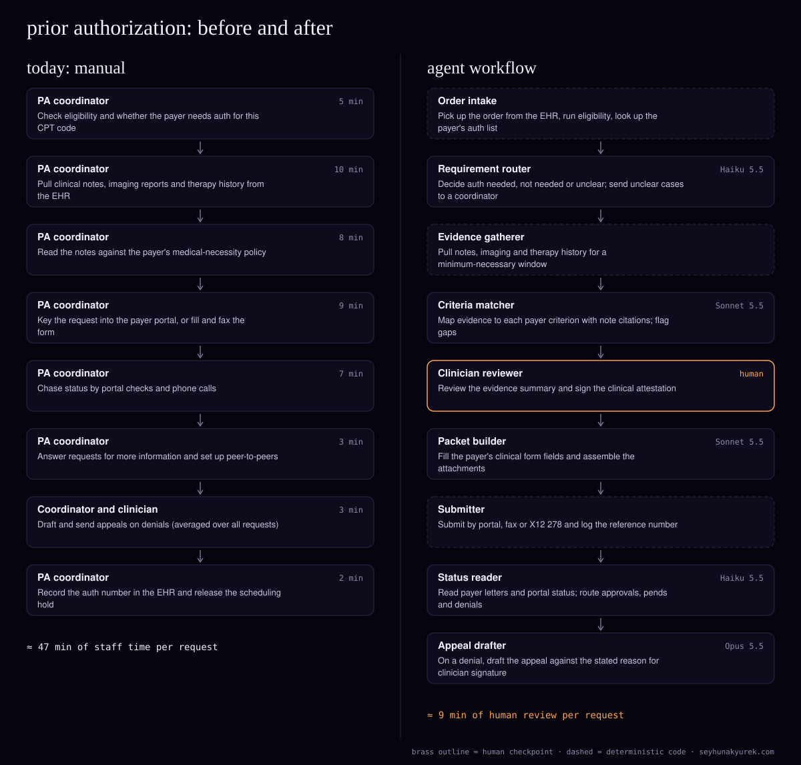

> Also published at https://seyhunakyurek.com/blog/prior-authorization-agent-workflow

Prior authorization is the queue that sits between a doctor ordering an MRI or a knee replacement and the patient actually getting it. Someone has to find out whether the payer wants an authorization, dig the right notes out of the chart, prove that the payer's criteria are met, submit it, and then chase it until a decision comes back.

In a multi-site orthopaedics and imaging practice, that someone is a team of prior-auth coordinators. The practice I model here sends about 3,000 prior-auth requests a month: advanced imaging (MRI, CT), injections, physical therapy extensions, and surgery. Every delay shows up as a rescheduled patient or an empty scanner slot.

I rebuilt the process as a multi-agent workflow. Agents check requirements, assemble evidence and submit. A clinician signs off anything clinical, and no agent decides medical necessity. That decision stays with the payer, and the clinical judgement in the request stays with the clinician.

The practice here is a composite: the volumes are typical for a multi-site US specialty group, and every cost below is computed from Claude API list prices on 10 November 2026.

## the process today

| step | who | minutes |
|---|---|---|
| Check eligibility and whether the payer needs auth for this CPT code | PA coordinator | 5 |
| Pull clinical notes, imaging reports and therapy history from the EHR | PA coordinator | 10 |
| Read the notes against the payer's medical-necessity policy | PA coordinator | 8 |
| Key the request into the payer portal, or fill and fax the form | PA coordinator | 9 |
| Chase status by portal checks and phone calls | PA coordinator | 7 |
| Answer requests for more information, set up peer-to-peers | PA coordinator | 3 |
| Draft and send appeals on denials (averaged over all requests) | Coordinator and clinician | 3 |
| Record the auth number in the EHR and release the scheduling hold | PA coordinator | 2 |
| **total** | | **47** |

At 3,000 requests a month, 47 minutes each is 2,350 staff hours a month, roughly 14 full-time coordinators. The minutes are my assumption for a practice of this shape, averaged across simple imaging requests and long surgical ones.

The time goes into reading, not typing. In step 3 a coordinator scrolls a year of notes looking for "six weeks of conservative therapy", because that is what the payer's MRI policy asks for. Errors come from the same place: a request goes out without the therapy notes buried in a scanned PDF, the payer pends it, and the clock restarts. The other source is the requirement check. Auth lists change, and a missed requirement becomes a denied claim weeks later.

## the agent architecture

The pattern is a pipeline with one branch. Prior auth is a fixed sequence (requirement, evidence, review, submit, track), and each stage needs the last one's output, so a pipeline is easier to audit than an orchestrator choosing what to do next. The branch is the denial path. In a regulated workflow I want to point at any request and say which step produced which field.

Four of the nine steps are deterministic code, not an LLM: intake, evidence gathering, submission and the EHR write-back. Demographics, member IDs and CPT codes are copied by code from the EHR and the eligibility response. The model never fills them, so it cannot get them wrong and never sees them.

### order intake (deterministic code)

It listens for new orders from the EHR (Epic, athenahealth or ModMed are common in orthopaedics) over the practice's existing HL7 feed or FHIR API. It runs eligibility through the clearinghouse (X12 270/271) and looks the CPT code up in a payer auth table a coordinator maintains. Output: an order record with payer, plan, codes and a rules-table verdict.

### requirement router (Haiku 5.5)

It decides "auth needed", "not needed" or "unclear" when the table is not enough: a conditional policy ("auth from the third PT visit"), or a new plan. Classification against a short policy excerpt is small-tier work, so Haiku 5.5. Inputs: the order record and the payer policy excerpt (cached). Output: a verdict, the policy sentence it relied on, and a confidence. Guardrails: below 0.90 confidence, any "not needed" on a code the table usually flags, and every surgical code go to a coordinator. A wrong "not needed" is the expensive error, so it is tuned to over-escalate.

### evidence gatherer (deterministic code)

It fetches documents without reading them: office notes, imaging reports, therapy notes, medications and the problem list, limited to a window that fits the order (say, 12 months and the relevant body site). That window is how the build applies HIPAA's minimum-necessary standard. Scans go through OCR. Output: dated, source-tagged text with document IDs.

### criteria matcher (Sonnet 5.5)

It maps the evidence to each criterion in the payer's policy. For a lumbar MRI: symptom duration, conservative therapy and for how long, red flags, prior imaging. Each criterion comes back "evidence found" with a quote and document ID, or "not found". It never returns "medically necessary". That call belongs to the payer, and the clinical case belongs to the clinician.

This is extraction with citations over 15,000 to 20,000 tokens of notes, so Sonnet 5.5, at half Opus's price. The policy and instructions are a stable, cached prefix. Guardrails: code confirms every quote appears verbatim in the cited document, or downgrades the criterion to "not found". Any required criterion not found stops the request and goes to a coordinator, because an incomplete packet just earns a pend.

### clinician reviewer (human)

A nurse, physician assistant or the ordering physician reviews the summary beside the cited notes and signs the clinical attestation. The design hangs on this: the agent prepares the case, a licensed person stands behind it. About three minutes on a clean imaging request, longer on surgery.

### packet builder (Sonnet 5.5)

It turns the signed summary into what the payer wants: a portal's clinical questions, a fax form, or the clinical part of a 278 request. Inputs: the signed summary and the payer's form schema (cached). Output: field values and an attachment list. Guardrail: code rejects any answer with a number or date not in the signed summary. A coordinator spends about five minutes checking the packet before release.

### submitter (deterministic code)

It submits through the channel each payer supports: a portal (often a multi-payer portal such as Availity, or the payer's own), a HIPAA-eligible fax service, or the X12 278 where the clearinghouse supports it. Portal submission is browser automation, which breaks when portals change, so any failure goes to a coordinator with a screenshot instead of a blind retry.

### status reader (Haiku 5.5)

It sorts faxed letters, portal statuses and information requests into approved, denied, pended or unclear. Routing work, so Haiku 5.5, on the Batch API because a few hours' delay changes nothing. Expedited requests skip the batch. Approvals go to code, which writes the auth number into the EHR and releases the scheduling hold.

### appeal drafter (Opus 5.5)

It runs only on denials, assumed at 12% of requests. It reads the denial reason against the packet and chart and drafts an appeal that answers the reason point by point, or says plainly that a peer-to-peer is the better route. That is the judgement-heavy step, so Opus 5.5, on the Batch API because appeal windows are days long. The clinician edits and signs every appeal.

### escalation rules

- Router confidence under 0.90, or any surgical code: a coordinator decides the requirement.
- A required criterion not found, or a citation failing the verbatim check: coordinator, before the clinician.
- Expedited requests: coordinator notified at intake; every batch step is skipped.
- Submission failure, unclear payer response, or any denial: coordinator queue.
- Retro-authorizations and out-of-network requests: manual in the pilot.

### HIPAA and CMS-0057-F

Every step that sends PHI to the model needs a business associate agreement with the model provider, and the API account configured the way that agreement requires. Confirm both before real patient data flows. Hosting, fax, logging and storage vendors need BAAs too. Prompts carry an internal request ID instead of the patient's name, and every call is logged with its inputs, outputs and signer.

The CMS Interoperability and Prior Authorization final rule (CMS-0057-F) matters, with limits. As I understand it, it covers Medicare Advantage, Medicaid and CHIP, and qualified health plans on the federal exchanges, not most employer plans. It brought decision timeframes and specific denial reasons from 2026, and requires those payers to offer a prior authorization API, with most API requirements due from January 2027. Check the current rule and each payer's timeline. For this build it means the submitter should let a payer API replace a portal script payer by payer. Commercial portals and fax will be around for a while.

## the exact flow

1. An order arrives. Intake runs eligibility and the rules table. Failed eligibility goes to a coordinator and stops.
2. If the table is not decisive, the router decides. Low confidence or a surgical code goes to a coordinator.
3. No auth needed: code records it with the policy citation and releases the order.
4. The evidence gatherer pulls documents. EHR timeouts retry three times with backoff, then queue for a coordinator.
5. The matcher maps evidence to criteria. A malformed response retries once, then goes to a coordinator.
6. A required criterion not found: the coordinator gets the missing note from the clinic, then step 5 re-runs.
7. The clinician signs the summary or sends it back with a comment.
8. The packet builder fills the payer's fields; the coordinator checks and releases.
9. The submitter sends and logs the reference number. Failures go to the coordinator.
10. The status reader processes responses in batches, or immediately for expedited requests.
11. Approved: code writes the auth number and dates to the EHR and releases the scheduling hold.
12. Pended: the coordinator gets the payer's question, and the flow returns to step 4 or 6.
13. Denied: the appeal drafter writes a draft or recommends a peer-to-peer; the clinician decides and signs. Denials also feed a weekly review of the rules table.

## the api costs

Per request, with the assumptions above. Cached input is the stable prefix: instructions plus payer policy or form schema. Because payer policies vary, I assume one in five calls writes the cache (billed at the cache-write rate) and four in five read it. The status reader and appeal drafter run on the Batch API at 50% off. Output allowances include thinking tokens.

| agent | model | input tokens | cached input tokens | output tokens | cost per unit |
|---|---|---|---|---|---|
| Requirement router | Haiku 5.5 | 1,500 | 6,000 | 300 | $0.00050 |
| Criteria matcher | Sonnet 5.5 | 18,000 | 12,000 | 2,500 | $0.06796 |
| Packet builder | Sonnet 5.5 | 6,000 | 5,000 | 1,500 | $0.02990 |
| Status reader (2 documents, batch) | Haiku 5.5 | 5,000 | 6,000 | 400 | $0.00045 |
| Appeal drafter (12% of requests, batch) | Opus 5.5 | 3,000 | 960 | 480 | $0.01136 |
| **total per request** | | | | | **$0.1102** |

The appeal drafter row is averaged over all requests: one appeal is 25,000 input, 8,000 cached and 4,000 output tokens, about $0.095 on the Batch API, and it runs on 12% of requests.

The arithmetic for the criteria matcher: 9,600 cached tokens read at $0.10 per million is $0.00096. 2,400 cached tokens written at $2.50 per million is $0.00600. 18,000 uncached input tokens at $2.00 per million is $0.03600. 2,500 output tokens at $10.00 per million is $0.02500. Total $0.06796.

At 3,000 requests a month, that is $330.49 a month in API costs, about $330. Without caching or batching the same workload would cost about $449 a month, so the two discounts save roughly a quarter. The matcher is 62% of the bill, which is where to look first if volume grows.

| item | monthly |
|---|---|
| Claude API | $330 |
| Other running costs (estimates): HIPAA-eligible cloud hosting $600, fax service $250, portal automation workers $400, observability and audit logs $200, storage $50 | $1,500 |
| **total running cost** | **$1,830** |
| Modelled staff hours saved (3,000 × 38 min) | 1,900 hours |
| Labour value at $32 an hour (loaded US prior-auth coordinator rate, my assumption) | $60,800 |

The 38 minutes saved per request is 47 manual minutes minus about 9 minutes of human review (five for the coordinator, three for the clinician, and about one averaged for appeals). That is an expected figure on a composite workload, not a measured result. It also leaves out effects I would not promise, such as fewer pends or faster approvals. The model API is not the cost that matters; the build and the review time are.

## what it will get wrong

- **A wrong "not needed".** The service goes ahead without auth. Caught by over-escalation (0.90, all surgery to a human) and a weekly match of denied claims against "not needed" verdicts.
- **A citation that is not in the chart.** Caught by the verbatim check in code.
- **Evidence that exists but was missed**, such as a misfiled PT note or an unreadable scan. Caught by "not found" stopping the request, and by tracking pends by cause.
- **Copied-forward text.** A templated "patient has tried PT" line treated as evidence. The matcher is told to prefer dated therapy notes and to flag summary-only evidence; the clinician sees the source.
- **Portal changes.** A redesign makes the script fail or fill the wrong field. Caught by checking each confirmation page against the packet and pausing that payer's automation on the first mismatch.
- **Partial approvals read as approvals.** Caught by code comparing approved units and dates to requested ones.
- **An appeal that overstates the chart.** Caught by the citation check and the mandatory clinician signature.

## how you know it works

Before go-live I build a golden set of 400 closed requests from the practice's own history, with known outcomes, stratified by payer, service type (imaging, injection, therapy, surgery) and outcome (approved, pended, denied). Coordinators and a clinician label the correct requirement verdict and the correct criterion-by-criterion evidence for each.

Metrics:

- **Requirement accuracy**, with false "not needed" counted separately. Bar: zero false "not needed" on the golden set, 97% overall.
- **Criterion-level accuracy** of the matcher: found versus not found, and whether the citation is correct. Bar: 95%, with every hallucinated citation caught by the verbatim check.
- **Field-level accuracy** of the packet against what a coordinator would submit. Bar: 98%.
- **Escalation rate.** Expected 25 to 35% in the pilot. Too low suggests thresholds are loose; too high means no time is saved.
- **Cycle time** from order to submission, and pends for more information per 100 submissions, compared against the practice's baseline.

Then four weeks of shadow mode on live orders, where the agents build packets and coordinators submit their own, and the two are compared. Go-live is per service line and per payer, once that combination meets the bar.

## the build plan

- **Week 1:** BAAs signed and accounts configured. Map EHR interfaces, payers and channels. Pull the golden-set requests. Agree the rules table with the coordinator lead.
- **Week 2:** Order intake, eligibility and the rules table. Evidence gatherer with minimum-necessary windows and OCR. Audit logging from day one.
- **Week 3:** Requirement router and criteria matcher for the top five payers and lumbar and knee MRI. First run against the golden set.
- **Week 4:** Clinician review screen with citations side by side. Packet builder for the same payers. Fix what the golden set found.
- **Week 5:** Submitter for two portals and fax. Status reader. End-to-end test on synthetic patients.
- **Weeks 6 to 7:** Shadow mode on live imaging orders. Weekly accuracy review with coordinators and a clinician.
- **Week 8:** Go-live for imaging on the payers that met the bar. Add injections and therapy.
- **Weeks 9 to 10:** Appeal drafter, surgical requests (with full review), more payers. Hand over the runbook and the rules-table process to the practice.

## run your own numbers

- Plug this workload into the [AI token cost estimator](https://seyhunakyurek.com/tools/ai-token-cost-estimator?model=claude-sonnet-5-5&requests=15360&input=12395&output=1012&cached=47&batch=41). It is pre-filled with 15,360 calls a month (5.12 calls per request), about 12,400 input and 1,000 output tokens per call, 47% of input cached and 41% of calls batched. The estimator prices everything on one model, so it lands a little under the mixed-model $330 above.
- Use the [agent workflow fit scorer](https://seyhunakyurek.com/tools/agent-workflow-fit-scorer) to check whether your own authorization queue is a good fit before you build anything.

If you run a prior-auth team and want these numbers for your payers and volumes, [get in touch](https://seyhunakyurek.com/contact).
