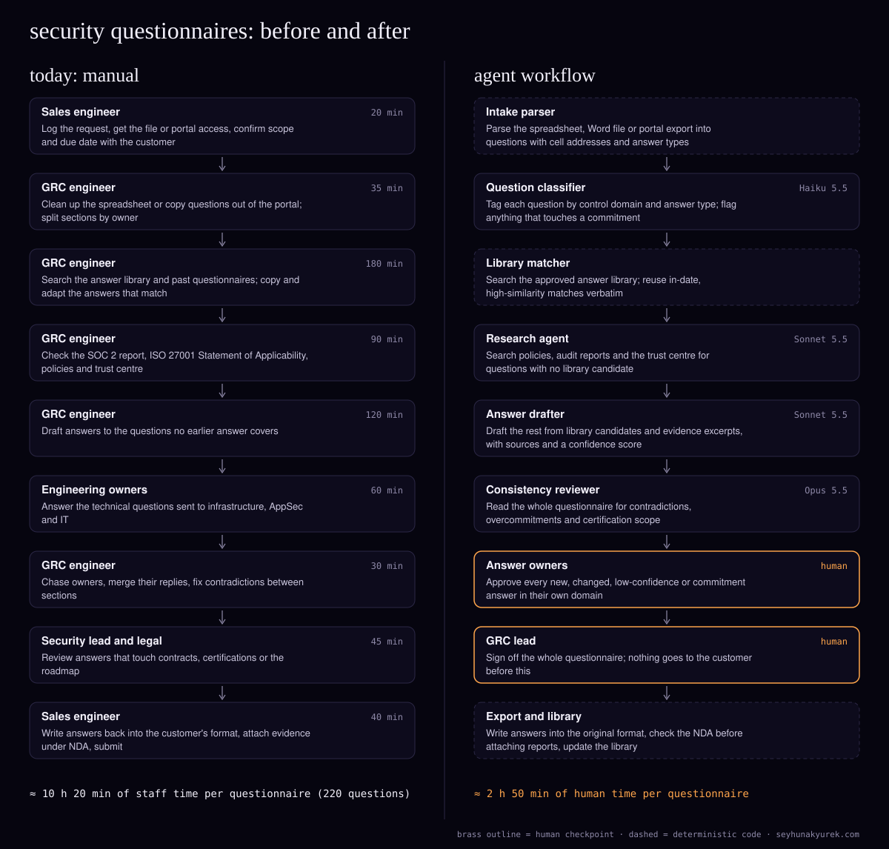

> Also published at https://seyhunakyurek.com/blog/security-questionnaire-agent-workflow

Every enterprise deal at a B2B SaaS vendor reaches the same gate. The buyer's security team sends a questionnaire: a SIG Lite or SIG Core workbook, a CAIQ, a custom Excel file, a supplier portal, or the security section of an RFP in Word. It has 100 to 400 questions, and the deal waits until it comes back.

The vendor here sells a mid-market SaaS product to US and European companies. It receives about 80 questionnaires a month, averaging 220 questions each. Security and GRC engineers answer them with help from sales engineers, engineering owners and, for the awkward ones, legal. Most questions have been answered before. Finding the old answer, checking it is still true, and getting the right person to approve the new ones is where the week goes.

Most of the work here is retrieval and formatting, which is plain code. The models classify questions, draft from approved sources, research the gaps and read the finished questionnaire for contradictions. People approve anything new, changed, uncertain or binding, and nothing goes to a customer without a named sign-off.

The vendor here is a composite: the volumes are typical for the segment, and every cost below is computed from Claude API list prices on 10 November 2026.

## the process today

| step | who | minutes |
|---|---|---|
| Log the request, get the file or portal access, confirm scope and due date | Sales engineer | 20 |
| Clean up the spreadsheet or copy questions out of the portal; split by owner | GRC engineer | 35 |
| Search the answer library and past questionnaires; copy and adapt matches | GRC engineer | 180 |
| Check the SOC 2 report, ISO 27001 Statement of Applicability, policies and trust centre | GRC engineer | 90 |
| Draft answers to questions no earlier answer covers | GRC engineer | 120 |
| Answer technical questions for infrastructure, AppSec and IT | Engineering owners | 60 |
| Chase owners, merge replies, fix contradictions between sections | GRC engineer | 30 |
| Review answers touching contracts, certifications or the roadmap | Security lead and legal | 45 |
| Write answers back into the customer's format, attach evidence under NDA, submit | Sales engineer | 40 |
| **Total per questionnaire (blended)** | | **620** |

That is about 10 hours 20 minutes per questionnaire, or 827 hours a month at 80 questionnaires. These are blended averages.

The time goes into search. The same question arrives in 30 phrasings, the old answers live in past spreadsheets, a wiki and someone's memory, and nobody knows which version legal last approved. The errors come from the same place. An answer copied from an 18-month-old questionnaire describes a backup setup that has since changed. Two sections of one questionnaire disagree on encryption at rest because two people answered them. A sales engineer under deadline writes "yes" to a control that is only partly in place, and that answer can end up in the contract's security exhibit. And the formatting step loses dropdown values or writes answers into the wrong column.

## the agent architecture

The pattern is a pipeline with one fork. Every questionnaire goes through parsing, classification and library matching in order. The matcher then routes each question: an exact, in-date library match is reused as is; a partial match goes to the drafter; no match goes to the research agent. Both routes meet at the consistency reviewer.

The part that matters most is not a model. It is the **approved answer library**: one entry per canonical question, with the approved answer, the owner, the date it was last reviewed, the source evidence (a policy section, a SOC 2 control, an architecture doc) and a flag for whether it states a commitment. The models draft from it; they don't replace it.

### intake parser (deterministic)

Code reads the file. For Excel it finds the question and answer columns, section headers, merged cells, hidden rows and data-validation dropdowns, and records the cell address for every answer. Word files are read table by table. Supplier portals vary; where the portal offers a spreadsheet export the parser takes that, and otherwise a sales engineer pastes the questions into a sheet. The output is one record per question: text, section, cell address, answer type (yes/no/N/A, free text, dropdown, evidence request) and allowed values.

If the parser can't find a consistent question column, or hidden rows contain text, the questionnaire stops and goes to a person.

### question classifier

- **Job:** tag each question with a control domain (access, encryption, logging, incident response, business continuity, HR, vendor management, privacy, AI use, and so on), confirm the answer type, and flag anything that touches a commitment: contract terms, legal liability, notification windows, roadmap, pricing, or certification and audit status.
- **Model:** Haiku 5.5. This is short classification, about 25 questions per call, nine calls per questionnaire.
- **Inputs and outputs:** the question records and a cached taxonomy with commitment rules; returns a domain, an answer type, a commitment flag and a confidence score per question. No tools.
- **Guardrails:** it runs in real time, so the sales engineer sees within a minute how many questions are new. Code also flags commitment keywords ("contract", "notify within", "certified", "will you", "planned"), and a question is commitment-flagged if either check says so.

### library matcher (deterministic)

Code runs a hybrid search (keyword plus embeddings) over the library and returns the top five candidates per question. A question reuses the library answer verbatim only when similarity is above 0.92, the answer type matches, the entry was reviewed in the last 12 months, and neither the entry nor the question is commitment-flagged. In this model that covers 55% of questions (121 of 220). Questions with a candidate above 0.6 go to the drafter (35%, 77 questions). The rest go to the research agent (10%, 22 questions).

### research agent

- **Job:** answer the questions the library has never seen, from primary sources.
- **Model:** Sonnet 5.5. A tool-calling loop over policy text and audit evidence, producing a draft that a person approves.
- **Tools (read-only):** search policies, search the evidence store (the SOC 2 report, the ISO 27001 Statement of Applicability, pen-test summaries, architecture docs), read the trust centre's public pages, and look up library entries. About five turns per question.
- **Outputs:** a draft answer, the sources it used with section references, a confidence score, and "unsupported" where it found nothing. Every research answer is new by definition, so every one goes to an owner.
- **Guardrails:** it can't write to the library or the questionnaire. Code checks each cited source exists and the quoted text is in it. An unsupported answer says so; it is never filled with a plausible guess.

### answer drafter

- **Job:** adapt library candidates to the question actually asked, in the customer's answer type and length.
- **Model:** Sonnet 5.5. Drafting from structured sources against a style guide.
- **Inputs and outputs:** about eight questions per call with their candidates and evidence excerpts, plus a cached style guide and the company fact sheet (hosting regions, encryption standards, SSO and MFA support, retention periods, audit scope). Returns the answer, the library entries and sources used, whether it is verbatim, adapted or new, and a confidence score.
- **Guardrails:** a yes/no answer must be one of the allowed values, with any qualification in the comment column. Code diffs each adapted answer against its library source and marks material changes.

### consistency reviewer

- **Job:** read the whole drafted questionnaire as the buyer will, and find what per-question drafting can't see: two answers that contradict each other, an answer that promises more than the contract template allows, a "yes" the evidence only partly supports, a roadmap item stated as a current capability, or a certification described more broadly than its scope.
- **Model:** Opus 5.5. This is the judgement step, and an overcommitment here can end up in a contract.
- **Inputs:** all questions and answers in compact form, plus a cached positions document: the standard notification windows and terms from the contract templates, the approved wording for audit and certification status, and a list of things the company never states.
- **Outputs:** a list of flagged answers with the reason and a risk level. No tools, no edits.

On certifications, the system is deliberately conservative. A SOC 2 report is an attestation by an independent CPA firm against the Trust Services Criteria, covering a defined system and period; it is not a certification. An ISO/IEC 27001 certificate has a scope, and the Statement of Applicability lists which controls apply. The models never assert either from memory. Audit and certification facts come only from the fact sheet the GRC lead maintains, and every answer that mentions them is commitment-flagged.

### human checkpoints

- **Answer owners** approve every answer that is new (all research answers), changed (an adapted answer that differs materially from its source), below 0.8 confidence, commitment-flagged, or flagged by the reviewer. Each domain has a named owner: infrastructure, AppSec, IT, privacy, HR. In this model that is about 55 answers per questionnaire, or 25%.
- **Legal or the security lead** approve every commitment-flagged answer: contract terms, notification windows, liability, roadmap.
- **The GRC lead** signs off the whole questionnaire. Verbatim library answers show collapsed, with their source and review date. Export is locked until sign-off.

## the exact flow

1. The sales engineer uploads the file or export and sets the due date. The parser builds question records; a parse failure goes back to the sales engineer within minutes.
2. The classifier tags every question in real time. A question it labels below 0.7 confidence goes to the GRC queue for manual tagging.
3. The matcher reuses in-date exact matches and routes the rest.
4. The research agent starts on no-match questions straight away, in real time. A failed tool call retries twice; a loop that passes eight turns stops and marks the question unsupported.
5. Partial matches join the evening Batch API job for the drafter, which typically returns within a few hours. A draft that fails the allowed-values or source check is regenerated once, then goes to the owner unanswered.
6. When both routes finish, the consistency reviewer runs as a second batch job. If it fails, the questionnaire goes to review without it and the GRC lead is told.
7. Next morning, owners see their flagged answers in a queue, grouped by domain.
8. The GRC lead reviews and signs off. Questionnaires due within two business days skip the batch jobs and run in real time.
9. Export writes each answer into its original cell, keeps dropdown values and formatting, and produces a paste sheet for portals. Confidential evidence, such as the SOC 2 report, is attached only if the CRM shows a signed NDA with that customer.
10. Approved new and changed answers go back into the library as candidates. They become reusable only when the owner marks them so, with a review date.

## the api costs

The unit is one questionnaire of 220 questions. Output figures include thinking tokens. The drafter and reviewer run through the Batch API at 50% off; the classifier and research agent run in real time.

Caching assumptions: the classifier's 3,000-token taxonomy is written once per questionnaire and read by the next eight calls. The drafter's 8,000-token style guide and fact sheet assume one write per 20 calls across the nightly batch (an effective $0.22 per million), and the reviewer's 12,000-token positions document one write per four calls (an effective $1.40 per million). These are modelling assumptions: batch cache hits are best effort. In the research loop, each turn writes its new tokens to the cache and reads everything before them, so that row's input column is billed at the cache-write rate.

| agent | model | input tokens | cached input tokens | output tokens | cost per unit |
|---|---|---|---|---|---|
| Question classifier (9 calls, real time) | Haiku 5.5 | 18,000 | 27,000 | 13,500 | $0.009165 |
| Research agent (22 questions × 5 turns, real time) | Sonnet 5.5 | 156,200 | 910,800 | 44,000 | $0.921580 |
| Answer drafter (10 calls, batch) | Sonnet 5.5 | 140,000 | 80,000 | 30,000 | $0.298800 |
| Consistency reviewer (1 call, batch) | Opus 5.5 | 40,000 | 12,000 | 4,000 | $0.128400 |
| Retries and re-drafts (10% of drafter and research) | Sonnet 5.5 | | | | $0.122038 |
| **Total per questionnaire** | | | | | **$1.479983** |

The research row, worked through for one question. Over five turns it sends 48,500 input tokens. 7,100 of them are new and written to the cache at $2.50 per million: $0.01775. The other 41,400 are cache reads at $0.10 per million: $0.00414. The 2,000 output tokens at $10.00 per million are $0.020. That is $0.04189 a question, and $0.92158 for 22 questions. Without caching the same loop costs $0.117 a question, nearly three times as much, because a tool loop resends its whole history every turn.

At 80 questionnaires the API bill is **about $118 a month**: research agent $73.73, drafter $23.90, reviewer $10.27, retries $9.76, classifier $0.73. Without caching or batching it would be about $316. If 10% of questionnaires are rushed and skip the batch jobs, add about $4.

| item | monthly |
|---|---|
| Claude API (all agents) | $118.40 |
| Embeddings and vector search for the library (estimate) | $70.00 |
| Hosting: parser, queue, workers, review screen (estimate) | $150.00 |
| Document and evidence storage (estimate) | $15.00 |
| Observability and LLM tracing (estimate) | $80.00 |
| **Total running cost** | **$433.40** |
| Staff time today (620 min × 80) | 827 hours |
| Staff time after (170 min × 80) | 227 hours |
| **Modelled hours saved** | **600 hours** |
| Labour value at $95/hour | $57,000 |

The $95 is an assumed fully loaded US rate, blended across security and GRC engineers and sales engineers; use your own. The 170 minutes is modelled as 55 flagged answers at 1.5 minutes each (82.5), 8 engineering-owner questions at 4 minutes (32), 6 commitment answers for legal at 3 minutes (18), a 20-minute final sign-off, 10 minutes of sales-engineer intake and submission, and 30 minutes of portal pasting on the quarter of questionnaires that arrive through a portal (7.5). The hours saved are capacity, not headcount.

## what it will get wrong

- **A stale answer reused verbatim.** The 12-month review rule blocks reuse of old entries, and a change to a policy or the fact sheet marks every library entry citing it for re-review.
- **A "yes" that should be "partially".** The drafter has to put qualifications in the comment column, and the reviewer checks yes answers against cited evidence. Owners see every adapted answer.
- **Certification scope stated too broadly.** Audit and certification wording comes only from the fact sheet; any mention is commitment-flagged and goes to the security lead.
- **A roadmap item stated as a current capability.** The classifier and keyword rules flag "planned" and "will you" questions, and the reviewer looks for future tense in present-tense answers.
- **The wrong cell.** Export writes by recorded cell address and checks that the question text in that row still matches. A mismatch stops the export.
- **Instructions hidden in the customer's file.** Hidden rows stop the parse, and question text is data. No agent can send, export or edit the library, so the worst case is a bad draft that a person rejects.
- **Confidential evidence sent too early.** The NDA check runs in code at export, not in a prompt.

## how you know it works

Build a golden set from 40 completed questionnaires, about 8,000 questions, with the answers that were actually approved and sent. Spread it across SIG Lite, SIG Core, CAIQ, custom spreadsheets and Word RFPs. Add 300 seeded traps: stale facts, contradictions planted across sections, roadmap questions, commitment questions, and hidden rows. Two GRC engineers grade a sample of drafts independently.

The bar for go-live:

- **Parse accuracy:** 99.5% of questions and answer cells found correctly, and 100% of hidden-row traps stopped.
- **Answer accuracy:** 95% of drafted answers accepted by graders as factually correct against the sources, with or without wording edits.
- **Commitment recall:** 100% of seeded commitment questions flagged. Pass or fail.
- **Contradiction catch:** 90% of planted contradictions found by the reviewer.
- **Citation accuracy:** 100% of cited sources exist and contain the quoted text.
- **Escalation rate:** 30% or fewer answers reach an owner (25% modelled).
- **Cycle time:** median time from upload to sign-off-ready under one business day.

Owner edits feed the golden set monthly, and the edit rate per domain shows which library entries need work.

## the build plan

- **Week 1:** collect the last year's questionnaires and the current answer sources; name an owner per domain; agree the commitment rules with legal.
- **Week 2:** build the library: dedupe past answers into canonical entries, attach sources, owners and review dates. This is the slowest week and the most valuable.
- **Week 3:** intake parser and export for SIG, CAIQ and custom Excel, tested round trip with no LLM.
- **Week 4:** classifier and matcher, tuned on the golden set.
- **Week 5:** drafter and research agent with read-only tools over policies and evidence.
- **Week 6:** consistency reviewer and the review screen; go through every golden-set flag with the GRC lead.
- **Week 7:** shadow mode: the team answers live questionnaires as usual, and the system drafts the same ones for comparison.
- **Week 8:** live for standard formats, every answer approved by an owner.
- **Week 9:** move to the flagged-only review once accuracy holds at the bar for two weeks; add Word RFPs and portal exports.
- **Week 10:** handover: runbook, library review cadence, monthly golden-set runs.

## run your own numbers

The [AI token cost estimator](https://seyhunakyurek.com/tools/ai-token-cost-estimator?model=claude-sonnet-5-5&requests=10400&input=10646&output=704&cached=74&batch=8) is pre-filled with this workload averaged across agents: 10,400 calls a month, 10,646 input and 704 output tokens per call, 74% of input cached, 8% of calls batched. It prices every call at Sonnet 5.5, so it reads differently from the mixed-model table above.

The research agent is a tool-calling loop whose context grows every turn, and it is most of the bill. The [agent loop cost calculator](https://seyhunakyurek.com/tools/agent-loop-cost-calculator) shows what more turns, larger tool results or no caching do to that cost. To size the golden set you need before trusting the 95% answer-accuracy bar, use the [AI accuracy proof calculator](https://seyhunakyurek.com/tools/ai-accuracy-proof-calculator).

If you want this mapped to your questionnaires, answer library and evidence, [book a 20-minute call](https://seyhunakyurek.com/contact).
