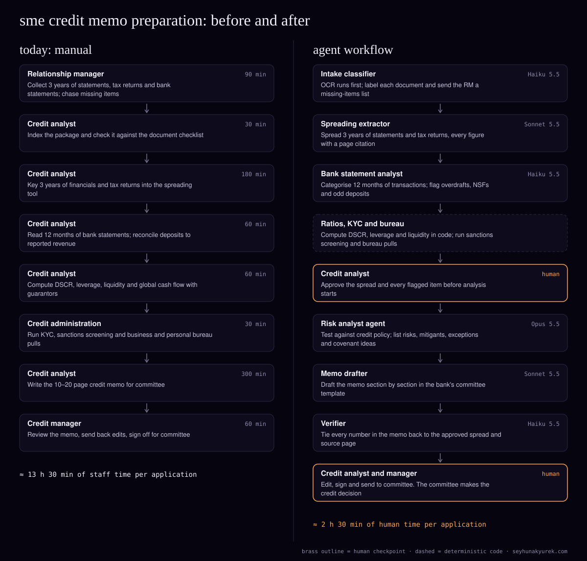

> Also published at https://seyhunakyurek.com/blog/sme-credit-memo-agent-workflow

Small-business lending at a mid-sized commercial bank has a quiet bottleneck. It is not the credit decision. It is the two working days of document handling, spreading, ratio work and writing that happen before anyone on the credit committee reads a word.

Relationship managers and credit analysts carry it. For a $250K to $5M loan, they collect three years of financial statements, tax returns and a year of bank statements, key the numbers into the spreading tool, compute the ratios, run KYC, sanctions and bureau checks, and then write a 10 to 20 page memo. At 400 applications a month, that is roughly 5,400 hours of skilled time, and the queue sets the bank's time to yes.

I designed an agent workflow that prepares the file and drafts the memo. It never approves anything. The committee still makes every credit decision, and an analyst signs every memo before it goes up.

The bank here is a composite: the volumes are typical for a US commercial bank of this size, and every cost below is computed from Claude API list prices on 10 November 2026.

## the process today

| step | who | minutes |
|---|---|---|
| Collect 3 years of statements, tax returns and bank statements; chase missing items | Relationship manager | 90 |
| Index the package and check it against the document checklist | Credit analyst | 30 |
| Key 3 years of financials and tax returns into the spreading tool | Credit analyst | 180 |
| Read 12 months of bank statements; reconcile deposits to reported revenue | Credit analyst | 60 |
| Compute DSCR, leverage, liquidity and global cash flow with guarantors | Credit analyst | 60 |
| Run KYC, sanctions screening, business and personal bureau pulls | Credit administration | 30 |
| Write the credit memo for committee | Credit analyst | 300 |
| Review the memo, send back edits, sign off | Credit manager | 60 |
| **total** | | **810** |

Most of the time goes into two places: spreading and writing. Spreading is slow because SME financials are inconsistent. One borrower sends CPA-reviewed statements, the next sends a QuickBooks export, a third sends only tax returns, and the analyst maps each line into the bank's chart of accounts by hand. The errors start there too. A transposed figure or a missed add-back for owner compensation flows straight into the debt service coverage ratio, and nobody re-checks it once the memo is written. The memo itself is mostly restating numbers that already exist, which is exactly why analysts find it tedious and why copy-paste errors between the spread and the memo are common.

## the agent architecture

The pattern is a pipeline with one human gate in the middle. I chose a pipeline over an orchestrator because the work has a fixed order: you cannot judge credit risk before the spread is right, and you cannot write the memo before the risk analysis exists. Each stage writes a typed record into the loan origination system (nCino, Baker Hill or similar), so any stage can be rerun on its own.

Four steps are plain code, not an LLM: OCR, ratio calculation, sanctions screening and bureau pulls. Anything that is arithmetic or a lookup against an authoritative source stays deterministic.

### intake classifier

- **Job:** label each document in the package (balance sheet, income statement, Form 1120-S, Schedule K-1, personal financial statement, bank statement, lease, debt schedule) and its period, then produce a missing-items list for the relationship manager.
- **Model:** Haiku 5.5. This is classification over short page text. A smaller model is accurate enough and costs a fraction of a cent per document.
- **Inputs:** OCR text of the first two pages of each of about 40 documents, plus a cached 2,000-token system prompt with the bank's document taxonomy.
- **Outputs and tools:** a document index in the origination system and a checklist message to the RM. OCR runs before it, through a document AI service such as AWS Textract or Azure Document Intelligence.
- **Guardrails:** any document classified below 0.85 confidence goes to a human index queue. The agent cannot request documents from the borrower directly; the RM does that.

### spreading extractor

- **Job:** spread three years of financial statements and tax returns into the bank's template, with a page and line citation on every figure. It also proposes normalising adjustments (owner compensation above market, one-off items) but marks them as proposals.
- **Model:** Sonnet 5.5. Extraction from messy tables with judgement about line mapping is Sonnet's tier.
- **Inputs:** six calls per application (three statements, three tax returns), each about 12,000 tokens of OCR text plus a cached 6,000-token mapping guide.
- **Outputs and tools:** a structured spread written to the spreading tool through its import API or file import (Moody's CreditLens, Abrigo or the origination system's spreading module, depending on what the bank runs).
- **Guardrails:** code checks that the balance sheet balances, that subtotals foot, and that tax return revenue is within 5% of statement revenue. Any failure blocks the file at the analyst gate. Proposed adjustments are never applied until the analyst accepts them.

### bank statement analyst

- **Job:** categorise 12 months of transactions, total true operating deposits, and flag overdrafts, NSF fees, large unexplained transfers and payments to other lenders that are missing from the debt schedule.
- **Model:** Haiku 5.5. A parser extracts the transactions first, so the model only does categorisation, which Haiku handles well.
- **Inputs:** one call per monthly statement, about 5,000 tokens of parsed transactions plus a cached 3,000-token category guide.
- **Outputs:** a cash-flow summary and a list of flags with transaction references.
- **Guardrails:** if operating deposits differ from reported revenue by more than 15%, the file is flagged. Undisclosed lender payments are always flagged.

### ratios, KYC and bureau (deterministic)

DSCR, leverage, liquidity and global cash flow are computed in code from the analyst-approved spread, using the bank's own formulas. The same step calls the bank's existing KYC and sanctions screening vendor (OFAC and other lists), pulls business bureau data (Experian Business, Equifax or Dun & Bradstreet) and personal bureau reports on guarantors, and, where the bank uses it, orders tax transcripts through IRS Form 4506-C. No model touches these numbers. A potential sanctions match stops the file and routes it to the BSA/AML team, not to the credit analyst.

### risk analyst agent

- **Job:** read the approved spread, ratios, bank statement flags, bureau summary and collateral details, test them against the bank's credit policy, and write a structured analysis: key risks, mitigants, policy exceptions, and covenant suggestions.
- **Model:** Opus 5.5. This is the one step where judgement quality matters most. Spotting that a 1.4x DSCR rests on a single customer contract, or that the guarantor's liquidity is mostly in the borrowing entity, is reasoning, not extraction.
- **Inputs:** about 43,000 tokens of file data across two calls, plus the 30,000-token credit policy as a cached prefix.
- **Outputs:** a risk record with every claim citing the spread line, ratio or document it rests on.
- **Guardrails:** it may not recommend approve or decline. Its output schema has no field for it. Every policy exception it lists must quote the policy clause.

### memo drafter

- **Job:** write the memo in the bank's committee template, one section per call: request and structure, borrower and management, industry, financial analysis, cash flow and repayment, collateral, guarantors, risks and mitigants.
- **Model:** Sonnet 5.5. Drafting from structured inputs into a fixed template does not need Opus.
- **Inputs:** a cached 45,000-token prefix (template, house style, the approved spread and the risk record) and a short instruction per section.
- **Outputs:** a draft memo in the origination system's document module.
- **Guardrails:** the drafter may only use numbers present in its inputs. It writes "[analyst to complete]" where information is missing rather than inventing it.

### verifier

- **Job:** check every number and ratio in the draft memo against the approved spread and source citations.
- **Model:** Haiku 5.5. Matching is cheap, so it runs on every memo.
- **Outputs:** a pass list and a mismatch list. Any mismatch sends the section back to the drafter once, then to the analyst.

### human checkpoints and escalation

There are two human gates. The first is after spreading: the credit analyst approves the spread, the proposed adjustments and every flag before any analysis runs. The second is the final memo: the analyst edits and signs, the credit manager reviews, and the file goes to committee.

Files escalate past the normal path when any of these hold:

- an extraction confidence below 0.9 on a key line (revenue, EBITDA, interest expense, total debt);
- a failed footing or balance check;
- any potential sanctions or adverse media match (to BSA/AML);
- any policy exception, or a request above $3M (to a senior credit officer before the memo is drafted);
- DSCR below the policy minimum. The agent flags it; it does not decide what it means.

## the exact flow

1. The RM uploads the package to the origination system. OCR runs on every page; failed pages retry twice, then go to a manual queue.
2. The intake classifier labels each document. Missing items go to the RM as a checklist. The file waits until the RM marks the package complete.
3. Overnight, the spreading extractor and bank statement analyst run through the Batch API. A failed request is resubmitted in the next batch; after two failures the file drops to manual spreading.
4. Code checks footing, balance and revenue consistency, then computes the ratios.
5. KYC, sanctions and bureau calls run. A potential match stops the file and alerts BSA/AML.
6. The credit analyst reviews the spread in the morning, accepts or rejects each adjustment and flag, and approves. Ratios are recomputed on the approved figures.
7. The risk analyst agent runs in real time against the cached credit policy. Exceptions or a request above $3M route to a senior credit officer.
8. The memo drafter writes eight sections. The verifier checks each one. A mismatch triggers one redraft, then goes to the analyst.
9. The analyst edits the memo; about 40% of files are expected to need a couple of sections redrafted on request.
10. The credit manager reviews and signs. The file goes to committee, which decides. Every prompt, output, model version and edit is logged.

## the api costs

Per application, at list prices. "Input" is uncached input plus cache writes; "cached" is cache reads.

| agent | model | input tokens | cached input tokens | output tokens | cost per unit |
|---|---|---|---|---|---|
| Intake classifier (40 calls) | Haiku 5.5 | 24,000 + 2,000 write | 78,000 | 3,200 | $0.00503 |
| Spreading extractor (6 calls, batch) | Sonnet 5.5 | 72,000 + 6,000 write | 30,000 | 18,000 | $0.17100 |
| Bank statement analyst (12 calls, batch) | Haiku 5.5 | 60,000 + 3,000 write | 33,000 | 14,400 | $0.00695 |
| Risk analyst (2 calls) | Opus 5.5 | 43,000 + 30,000 write | 30,000 | 12,000 | $0.56800 |
| Memo drafter (8 calls) | Sonnet 5.5 | 16,000 + 45,000 write | 315,000 | 20,000 | $0.37600 |
| Verifier (1 call) | Haiku 5.5 | 35,000 + 2,000 write | 0 | 3,000 | $0.00525 |
| Rework (40% of files, 2 redrafts) | Sonnet 5.5 | 2,400 + 18,000 write | 18,000 | 2,000 | $0.07160 |
| **total per application** | | | | | **$1.20383** |

At 400 applications a month, that is **$481.53 a month** in API cost.

The arithmetic for the risk analyst row: 43,000 uncached input tokens at $4.00 per million is $0.172. The 30,000-token policy written to cache once costs 30,000 × $5.00 / 1M = $0.150. The second call reads it at $0.20 per million, which is $0.006. Output, including a thinking allowance of about 8,000 tokens, is 12,000 × $20.00 / 1M = $0.240. Total $0.568.

Some notes on the assumptions:

- **Caching.** With about 20 applications a working day, the 5-minute cache usually expires between files, so I price one cache write per agent per application and cache reads only within a file. That is conservative. The memo drafter benefits most: one 45,000-token write, then seven reads at a twentieth of the input price.
- **Batch.** Only the spreading extractor and bank statement analyst use the Batch API, at 50% off every token class. They run overnight and nobody is waiting on them. Cache hits inside a batch are best-effort, so I priced those steps with a full cache write per application. Everything after the analyst gate runs in real time, because the analyst is waiting.
- **Thinking.** Output columns include thinking tokens: about 8,000 for the risk analyst, about 1,000 per call for the spreading extractor and memo drafter.
- **Without caching or batch,** the same workload would cost $2.13 per application, or $852.32 a month.

| line | monthly |
|---|---|
| API cost (above) | $481.53 |
| OCR, est. 280 pages per application at $0.015 per page | $1,680 |
| Hosting and queue workers, est. | $600 |
| Document storage, est. | $150 |
| Observability and LLM tracing, est. | $400 |
| **total running cost** | **$3,311.53** |
| Modelled staff time saved: (810 − 150) min × 400 applications | 4,400 hours |
| Labour value at a fully loaded US rate of $70 per hour | $308,000 |

That is about $8.28 of running cost per application. OCR costs more than every agent combined. The labour figure is capacity, not a headcount plan. In practice banks use it to cut time to decision and to let analysts spend their hours on the files that need judgement.

## what it will get wrong

- **Mis-mapped lines in the spread.** A "due to shareholder" line read as equity instead of debt changes leverage materially. Caught by the analyst gate, by footing checks, and by tracking which mappings analysts override so the mapping guide improves.
- **Adjustments that flatter the borrower.** The extractor may propose add-backs that are aggressive. They are proposals only, shown with the before and after DSCR, and the analyst accepts each one.
- **Missed related-party exposure.** K-1s can reveal affiliates the RM never mentioned. The risk analyst checks them against the guarantor list, but this stays on the analyst's checklist too.
- **Plausible but unsupported narrative.** The industry and management sections are where a drafter is most tempted to fill gaps. The rule is that every sentence must cite a source or carry "[analyst to complete]", and the verifier flags uncited claims.
- **Stale policy.** If the credit policy changes and the cached prefix is not updated, the risk analyst tests against the old rules. The policy document is versioned, and its version is printed in the memo footer.
- **OCR failures on scanned returns.** Low-quality scans produce wrong digits. Per-field OCR confidence is carried through, and low-confidence figures are highlighted in the analyst view.

## how you know it works

Build a golden set of 150 past applications with their final analyst-approved spreads and signed memos, stratified by loan size, industry and outcome, including declines and files with known exceptions.

Metrics:

- **Field-level spread accuracy** on 40 key lines, against the final spread. Bar: 99% or better on revenue, EBITDA, interest, total debt and equity, 97% overall.
- **Ratio agreement:** with the same approved spread, the code must match the bank's own ratios exactly.
- **Verifier catch rate** on 200 deliberately seeded number errors in memos. Bar: 98%.
- **Escalation rate.** Expect 20% to 35% of files to hit at least one escalation trigger.
- **Cycle time** from complete package to committee-ready memo, and analyst minutes per file, measured in a shadow run.
- **Memo quality,** scored blind by two senior credit officers on a 1 to 5 rubric against the human-written memo for the same file.

Run four weeks in shadow mode, with agents preparing files in parallel to the normal process. Go live only when the bars hold.

Model risk management is the other gate. In the US, many banks treat a workflow like this as a model or model-like tool under their policy built on the Federal Reserve's SR 11-7 guidance (adopted by the OCC as Bulletin 2011-12). Whether it formally counts as a model is the bank's own call, but expect an independent validation of the design, the golden-set results, ongoing monitoring and change control for prompts and model versions. The bank's third-party risk management process will also want to review the API provider. Because the workflow prepares rather than decides, the committee's documented reasons remain the basis for any adverse action notice under the bank's existing ECOA and Regulation B process.

## the build plan

- **Week 1.** Document taxonomy, spread template mapping, and access to the origination system and spreading tool sandboxes. Pull and anonymise the golden set.
- **Week 2.** OCR pipeline, intake classifier, and the missing-items checklist to RMs.
- **Week 3.** Spreading extractor with citations and footing checks. First accuracy run on the golden set.
- **Week 4.** Bank statement analyst, ratio code, and the KYC, sanctions and bureau integrations through the bank's existing vendors.
- **Week 5.** Analyst review screen, risk analyst agent, and the escalation rules.
- **Week 6.** Memo drafter and verifier in the committee template. Full golden-set evaluation and fixes.
- **Weeks 7 to 8.** Shadow run on live files with two analysts. Start model risk documentation.
- **Weeks 9 to 10.** Independent validation, fixes from it, go-live on loans under $1M first, then the full range.

## run your own numbers

The [AI token cost estimator](https://seyhunakyurek.com/tools/ai-token-cost-estimator?model=claude-sonnet-5-5&requests=27920&input=12355&output=1040&cached=58&batch=26) is pre-filled with this workload: about 27,920 API calls a month, 12,355 average input tokens and 1,040 output tokens per call, 58% of input cached and 26% of calls batched. It prices everything at one model, so treat it as a single-model approximation of the mixed table above.

To check whether your own credit workflow is a good fit before building anything, try the [agent workflow fit scorer](https://seyhunakyurek.com/tools/agent-workflow-fit-scorer).

If you want this mapped onto your bank's process and systems, [book a call](https://seyhunakyurek.com/contact).
